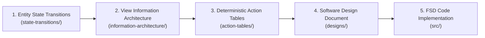

# Architecture: smb-ops-ui

This directory contains the Unified Process (UP) architecture plane for smb-ops-ui.

## Disciplines

* `adr/`: Architectural Decision Records (MADR 3.0 format)
* `designs/`: Software Design Documents
* `use-cases/`: Functional use cases
* `risk/`: Master Risk Register
* `state-transitions/`: Entity State Transition Specifications (entity lifecycles, statecharts)
* `information-architecture/`: View Information Architecture Matrices (read models, contextual decision fields)
* `action-tables/`: Deterministic Action Tables (interaction flows, mutations, redirects)

## Frontend Design Workflow Pipeline

When defining new frontend screens, workflows, or updates, follow this sequential pipeline:

1. **Entity State Transitions (`state-transitions/`):** Define the entity lifecycle, valid states, and guard rules.
2. **View Information Architecture (`information-architecture/`):** Define what fields the operator must see on the view to make decisions and map backend queries.
3. **Deterministic Action Tables (`action-tables/`):** Map every click, submit, and transition to exact API mutations, loading states, and redirects.
4. **Software Design Document (`designs/`):** Synthesize the complete feature or page design.
5. **FSD Code Implementation (`src/`):** Implement the slices into `entities/`, `features/`, `widgets/`, and `pages/`.
