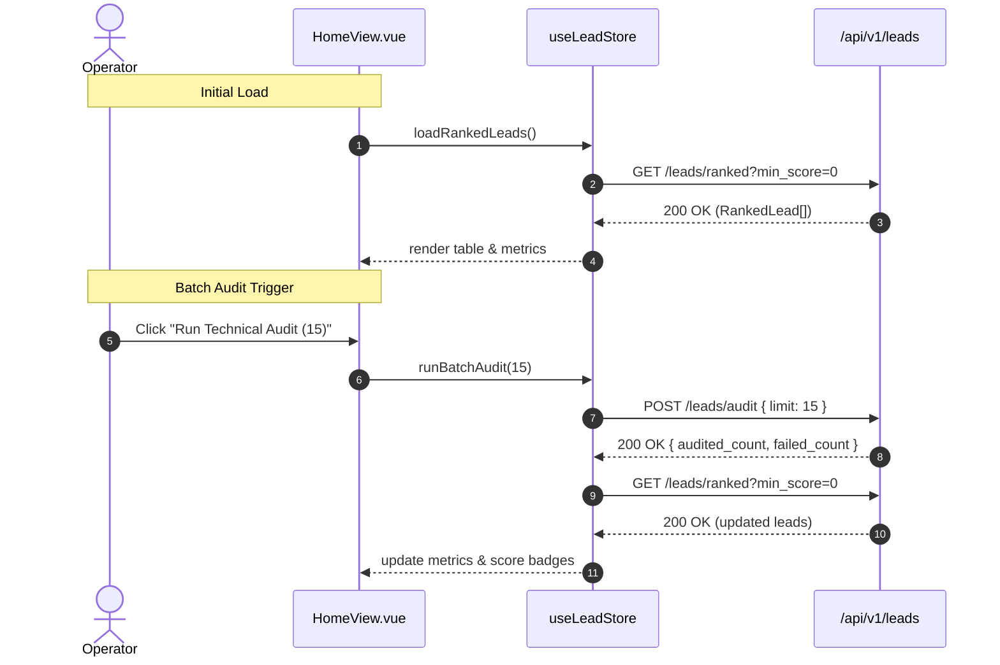

# 0001: Lead Operations Action Table (As-Is)

## 1. Flow Scope

* **Primary Page:** `pages/HomeView.vue` (`/`)
* **Associated Backend Use-Cases:**
  * `0001_discover_prospective_leads.md` (`POST /api/v1/leads/discover`)
  * `0002_audit_prospect_infrastructure.md` (`POST /api/v1/leads/audit`)
  * `0003_list_ranked_leads.md` (`GET /api/v1/leads/ranked`)

## 2. Deterministic Action Table (As-Is)

| Source View | Control / Trigger | Event / Intent | Backend Mutation | In-Flight / Loading State | Success Outcome | Error Outcome |
| :--- | :--- | :--- | :--- | :--- | :--- | :--- |
| `/` Header | Click "+ Add Lead" | `OPEN_CREATE_MODAL` | None | Open `CreateLeadModal` | Modal visible, form inputs focused | None |
| `<CreateLeadModal>` | Submit form | `SUBMIT_CREATE_LEAD` | `POST /api/v1/leads` | Store `loading=true` | Close modal, banner "Added lead: {name}", reload ranked leads | Banner error message, keep modal open |
| `/` Discovery Bar | Click "Discover" | `TRIGGER_DISCOVERY` | `POST /api/v1/leads/discover` | Store `loading=true`, banner "Discovering..." | Banner "Discovered N prospects.", reload ranked leads | Banner error "Discovery failed" |
| `/` Batch Audit | Click "Run Technical Audit" | `TRIGGER_BATCH_AUDIT`| `POST /api/v1/leads/audit` | Store `loading=true`, banner "Running batch..." | Banner "Audited X leads (Y failed).", reload ranked leads | Banner error "Audit batch failed" |
| `/` Filter Section | Select Score Dropdown | `FILTER_MIN_SCORE` | None | Instant computed re-filter | Table updates rows instantly (0, 40, 70) | None |
| `/` Table Row | Click row | None | None | None | **No action / Dead row** | None |
| `/` Table Row | External Link | `OPEN_WEBSITE` | None | Open browser new tab | Navigate to restaurant site | None |

## 3. Flow Sequence Diagram (As-Is)

