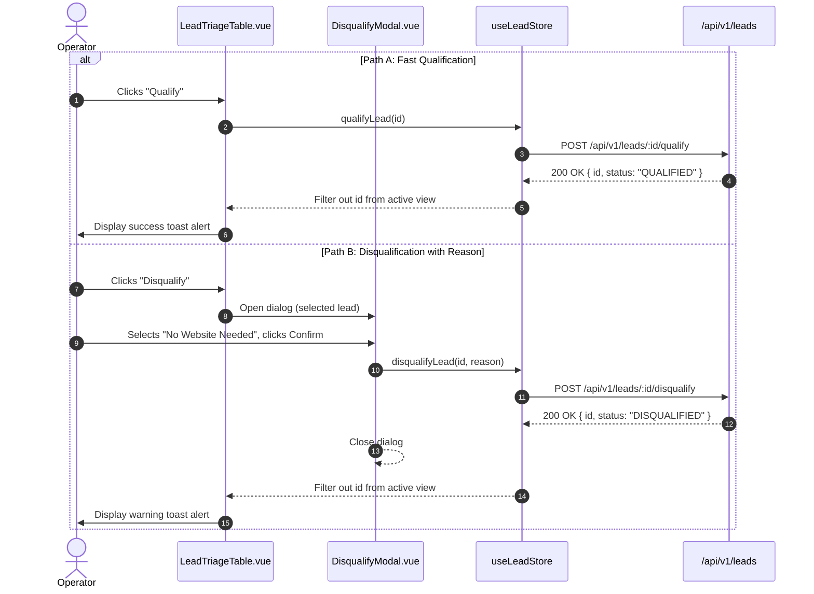

# 0002: Lead Row Triage & Disposition Action Table (Target Specification)

## 1. Flow Scope

* **Primary Page:** `pages/HomeView.vue` (`/`)
* **Target Components:** `features/lead-triage/LeadTriageTable.vue`, `features/lead-triage/DisqualifyModal.vue`
* **Associated Use-Cases:**
  * Backend Use-Case: `0004_qualify_prospect_lead.md` (`POST /api/v1/leads/:id/qualify`)
  * Backend Use-Case: `0005_disqualify_prospect_lead.md` (`POST /api/v1/leads/:id/disqualify`)
* **Supersedes / Extends:** `0001_lead_operations_action_table.md`

## 2. Deterministic Action Table

| Source View | Control / Trigger | Event / Intent | Backend Mutation | In-Flight / Loading State | Success Outcome & Navigation | Error Outcome |
| :--- | :--- | :--- | :--- | :--- | :--- | :--- |
| Table Row | Click "Qualify" Button | `QUALIFY_LEAD` | `POST /api/v1/leads/:id/qualify` | Row action spinner, buttons disabled | Toast "Lead marked QUALIFIED", row animated removal from active table, metrics ribbon increment | Toast banner "Failed to qualify lead", re-enable buttons |
| Table Row | Click "Disqualify" Button | `OPEN_DISQUALIFY_DIALOG` | None | None | Open `<DisqualifyModal>` passing selected lead context, autofocus reason dropdown | None |
| `<DisqualifyModal>` | Click "Cancel" / Backdrop | `DISMISS_DISQUALIFY_DIALOG` | None | None | Close modal, retain original lead row state | None |
| `<DisqualifyModal>` | Submit "Confirm Disqualify" | `CONFIRM_DISQUALIFY` | `POST /api/v1/leads/:id/disqualify` `{ reason, notes }` | Submit button spinner, inputs disabled | Close modal, toast "Lead DISQUALIFIED", row removed from table, metrics updated | Modal inline error banner with error detail, preserve form inputs |
| Table Row | Click Lead Business Name | `OPEN_LEAD_DETAIL` | None | None | Open side inspection drawer `<LeadDetailDrawer>` with full DNS, tech findings, and raw metadata | None |

## 3. Flow Sequence Diagram

## 4. Test Verification Checklist

* [ ] Clicking "Qualify" executes `POST /api/v1/leads/:id/qualify` with valid ID.
* [ ] Row immediately shows loading spinner while request is pending.
* [ ] Successful qualification immediately removes the lead from the active table list.
* [ ] Disqualify modal requires selecting a valid reason before enabling the confirm button.
* [ ] Disqualification payload contains both `reason` and optional `notes`.
* [ ] Server-side 500 error surfaces an observable toast notification and does not corrupt table state.
