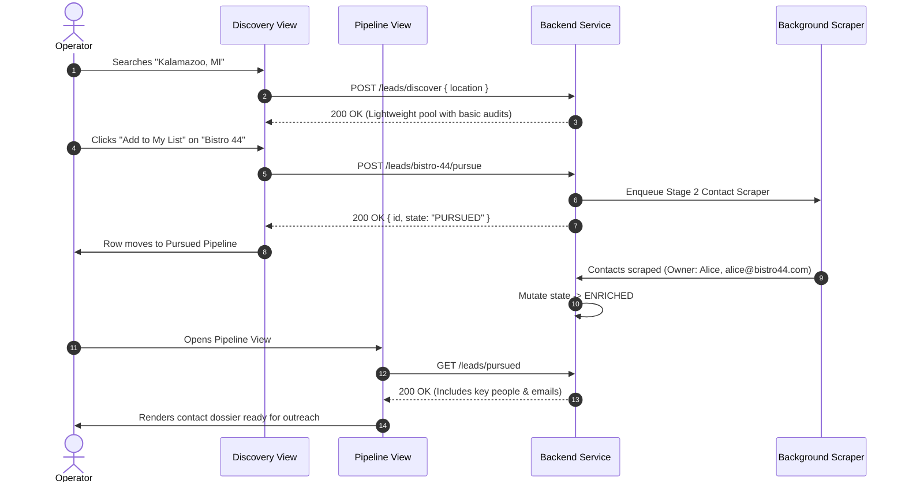

# 0003: Service-Driven Operations Action Table

## 1. Flow Scope

This specification defines user actions across the Discovery Pool, Pursued Pipeline, and Client Workspaces.

* **Primary Pages:**
  * `pages/DiscoveryPoolView.vue` (`/discovery`)
  * `pages/PursuedPipelineView.vue` (`/pipeline`)
  * `pages/ClientAccountsView.vue` (`/clients`)
* **Associated Backend Capability Areas:**
  * Service Catalog queries (`GET /api/v1/services`)
  * Stage 1 Discovery & Scanning (`POST /api/v1/leads/discover`)
  * Stage 2 Pursuit & Enrichment (`POST /api/v1/leads/:id/pursue`)
  * Suppression / Blacklisting (`POST /api/v1/leads/:id/suppress`)
  * Conversion to Client (`POST /api/v1/leads/:id/convert`)

---

## 2. Deterministic Action Table

| Source View | Control / Trigger | Event / Intent | Backend Mutation | In-Flight State | Success Outcome | Error Outcome |
| :--- | :--- | :--- | :--- | :--- | :--- | :--- |
| `/discovery` | Enter City/Zip + Click "Search" | `QUERY_DISCOVERY_POOL` | `POST /api/v1/leads/discover` `{ location }` | Table skeleton loader, search button spinner | Renders discovered pool rows; updates pool count | Toast error "Location search failed" |
| `/discovery` | Click Service Filter Pill (e.g. `SEO`) | `FILTER_BY_SERVICE` | None | Instant client filter | Rows re-filtered to show leads matching service | None |
| `/discovery` | Click Score Badge | `OPEN_SCORE_RUBRIC` | None | None | Opens `<ScoreRubricModal>` showing exact point breakdown | None |
| `/discovery` | Click "Add to My List" | `CLAIM_PURSUED_LEAD` | `POST /api/v1/leads/:id/pursue` | Button spinner "Adding..." | Lead removed from pool; toast "Added to Pursued Pipeline (Enrichment enqueued)"; badge count on `/pipeline` increments | Toast error "Failed to claim lead", re-enable button |
| `/discovery` | Click "Suppress" (Trash icon) | `SUPPRESS_PROSPECT` | `POST /api/v1/leads/:id/suppress` | Row opacity reduced | Lead removed from pool; toast "Business suppressed from future searches" | Toast error "Failed to suppress" |
| `/pipeline` | Click Lead Row | `INSPECT_LEAD_DOSSIER`| `GET /api/v1/leads/:id` | Drawer loading spinner | Opens side drawer with Enriched Contacts (Owner, Phone, Email, Tech Stack) | Toast error "Failed to load lead dossier" |
| `/pipeline` | Click "Log Outreach" | `OPEN_OUTREACH_MODAL` | None | None | Opens `<LogOutreachModal>` with channel (Email/Call/Visit) | None |
| `<LogOutreachModal>` | Submit Outreach | `SUBMIT_OUTREACH` | `POST /api/v1/leads/:id/outreach` | Submit button spinner | Updates state to `CONTACTED` or `FOLLOW_UP`, records note in timeline | Modal error alert, keep form open |
| `/pipeline` | Click "Convert to Client" | `CONVERT_LEAD` | `POST /api/v1/leads/:id/convert` | Button spinner | Opens `<NewClientConfirmationModal>`, generates `client_id`, redirects to `/clients` | Toast error "Conversion failed" |
| Top Nav | Click "+ Add Lead" | `OPEN_MANUAL_LEAD` | None | None | Opens `<CreateLeadModal>` (retained for manual walk-ins) | None |

---

## 3. Two-Stage Enrichment Sequence Diagram

