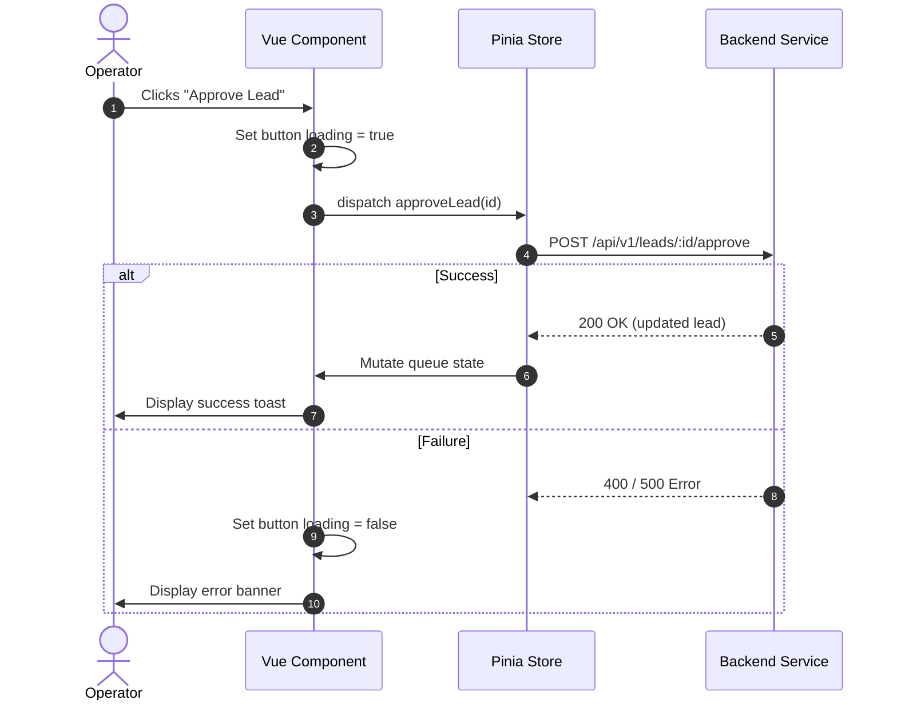

# Deterministic Action Tables

## Purpose

The **Deterministic Action Table** maps every discrete user action (button click, form submission, filter change, modal dismiss) to its exact technological consequence. It bridges UI interaction, network communication, client state changes, and route navigation into a single human- and LLM-readable contract.

Both human developers and LLM agents reference this document to:
* Implement Vue components and composables with predictable event handlers.
* Author End-to-End (Playwright) and Component (Vitest) test suites directly from specifications.
* Eliminate ambiguity regarding loading spinners, disabled states, error banners, and page redirects.

## File Naming Convention

All specification documents in this directory must follow sequential four-digit numbering:
```text
0001_<flow_or_feature_name>_action_table.md
0002_lead_triage_flow_action_table.md
```

## Schema & Core Properties

Every document authored in this directory must define the following properties:

1. **Flow Scope:** The user journey or feature slice covered (e.g., Lead Triage & Qualification Flow).
2. **Deterministic Action Table:** Tabular mapping containing:
   * `Source View`: Active route, modal, or component drawer.
   * `Control / Element`: Button label, shortcut, or UI trigger element.
   * `Event / Intent`: Named domain event (e.g., `ACCEPT_LEAD`).
   * `Backend Mutation`: HTTP method and API endpoint executed.
   * `Optimistic / In-Flight State`: Client feedback during request processing.
   * `Success Consequence`: Next route, toast alert, or local state change.
   * `Error Consequence`: Form inline error or toast banner notification.
3. **Flow Diagram:** Mermaid `flowchart LR` or `sequenceDiagram` illustrating the happy and error paths.

## Document Template

Use the following template when authoring a new deterministic action table document:

```markdown
---
title: "000X: <Flow Name> Action Table"
tags: ["architecture", "action-tables", "<flow-slug>"]
created_at: "YYYY-MM-DD"
last_updated_at: "YYYY-MM-DD"
---

# 000X: <Flow Name> Action Table

## 1. Flow Scope

* **Feature Slice:** `features/<feature-name>`
* **Primary Page:** `pages/<page-name>` (`/<route>`)
* **Associated Use Case:** `smb-ops-backend/architecture/use-cases/000X_<use_case>.md`

## 2. Deterministic Action Table

| Source View | Control / Trigger | Event / Intent | Backend Mutation | In-Flight / Loading State | Success Outcome & Redirect | Error Outcome |
| :--- | :--- | :--- | :--- | :--- | :--- | :--- |
| `/triage` | Click "Approve Lead" | `APPROVE_LEAD` | `POST /api/v1/leads/:id/approve` | Button loading spinner, inputs disabled | Toast "Lead approved", remove row from queue, remain on `/triage` | Toast error banner "Failed to approve", re-enable button |
| `/triage` | Click "Disqualify" | `DISQUALIFY_LEAD` | None | Open `<DisqualifyModal>` | Focus input field in modal | None |
| `<DisqualifyModal>` | Submit "Confirm" | `CONFIRM_DISQUALIFY` | `POST /api/v1/leads/:id/disqualify` | Modal button spinner | Close modal, toast "Disqualified", redirect to `/triage` | Modal inline alert with validation error |

## 3. Flow Sequence Diagram



## 4. Test Verification Checklist

* [ ] Clicking button dispatches exact HTTP payload.
* [ ] Button enters disabled/loading state during network latency.
* [ ] Success updates store and executes specified redirect.
* [ ] Failure renders error feedback without losing form input state.
```
