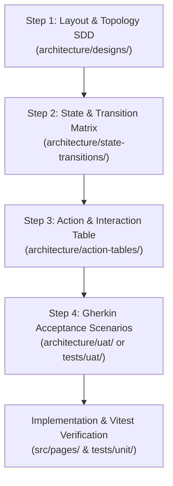

# ADR-0031: Systematic Frontend Workflow and Layout Specification Procedure

## Context and Problem Statement

Following the completion of component primitives and presentation atoms in `/dev/components` (e.g., `BaseMetricCard`, `BaseAlert`, `BaseDrawer`, `BaseCard`, `ScoreBadge`, `IssueChips`, and decoupled forms), the engineering team faces the challenge of refactoring main operational views (such as `DashboardView.vue`).

Historically, frontend view assembly often jumps directly from atomic components to writing complex Vue templates and Pinia store bindings. This approach produces recurring failure modes:
1. **Layout Ambiguity:** View templates undergo repeated CSS rewrites as container nesting, flex distributions, and responsive breakpoint rules are invented on the fly.
2. **State Machine Blindspots:** Loading, empty, error, and mutating states are addressed reactively, causing UI flicker, race conditions, or unhandled exceptions.
3. **Event Contract Drift:** Event names, prop shapes, and payload dispatches diverge between child components and parent page shells.
4. **Behavioral Regression:** Verifying user journeys and multi-step workflows relies on manual clicking, making defect localization costly and time-consuming.

A systematic, deterministic specification procedure is required before assembling pages and complex workflows to minimize debugging, eliminate rework, and provide clear architectural guardrails.

## Decision Drivers

* **Zero Layout Churn:** Layout hierarchy, grid/flex mechanics, and token assignments must be resolved before writing view components.
* **Exhaustive State Coverage:** Every view must define explicit behavior for idle, loading, empty, populated, mutating, and error conditions.
* **Deterministic Event Mapping:** All UI triggers must map strictly to internal emissions, store actions, or API routes.
* **Automated Behavioral Verification:** Business workflows and acceptance criteria must be expressed in human-readable and testable Gherkin scenarios.
* **Separation of Concerns:** Distinct architectural artifacts must handle visual topology, state transitions, interaction mechanics, and user journey validation.

## Considered Options

1. **Gherkin-Only Specification:** Write `.feature` files describing all user interactions and rely solely on Gherkin to dictate UI assembly.
2. **Ad-Hoc Prototyping:** Assemble views directly in code and refactor iteratively as integration bugs arise.
3. **4-Step Systematic Execution Workflow:** Enforce a layered 4-step procedure decoupling Layout Wireframes, State Transition Matrices, Action Tables, and Gherkin Behavioral Scenarios.

## Decision Outcome

Chosen option: **Option 3: 4-Step Systematic Execution Workflow**.

Gherkin excels at defining behavioral workflows, user journeys, and acceptance tests, but is ill-suited for specifying CSS layout topology, responsive breakpoints, design token usage, or event payload schemas. The 4-step procedure separates these concerns into distinct, mutually reinforcing artifacts.

---

## The 4-Step Systematic Specification Architecture



---

### Step 1: Layout & Topology Specification (SDD)

#### WHAT
The Layout Specification defines the structural component hierarchy, spatial grid/flexbox regions, responsive viewport breakpoints, and CSS design token bindings. It establishes the physical skeleton of the view before wiring any logic.

#### HOW
1. Document the component tree showing container shells, presentation atoms, and slotted primitives.
2. Define the responsive breakpoint grid using standardized tokens (`var(--spacing-*)`, `var(--color-*)`).
3. Author the document under `architecture/designs/XXXX_<view_name>_layout_and_topology_spec.md`.

#### Standard Template & Example
```markdown
# Software Design Document: Lead Dashboard Layout & Topology

## 1. Visual Topology & Component Hierarchy
+-----------------------------------------------------------------------------------+
| AppHeader / Navigation Rail (BaseAside)                                           |
+-----------------------------------------------------------------------------------+
| Top Ribbon: BaseAlert (Conditional Banner)                                        |
+-----------------------------------------------------------------------------------+
| Metric Grid (4-column on desktop, 2-column on tablet, 1-column on mobile)         |
| [ BaseMetricCard ] [ BaseMetricCard ] [ BaseMetricCard ] [ BaseMetricCard ]       |
+-----------------------------------------+-----------------------------------------+
| Primary Stage (Grid: 8fr / 4fr)                                                   |
| - Left Stage: LeadTriageTable           | - Right Stage: ActivityFeed / Aside     |
|   - QuickFilterBar                      |   - QuickActionButtons                  |
|   - LeadRow Items                       |   - ContextualNotes                     |
+-----------------------------------------+-----------------------------------------+

## 2. Component Hierarchy Tree
DashboardView.vue
├── BaseAlert.vue (status notification slot)
├── section.metrics-ribbon
│   └── BaseMetricCard.vue (v-for kpi in metrics)
└── div.dashboard-main-grid
    ├── section.triage-pane
    │   ├── LeadFilterBar.vue
    │   └── LeadTable.vue
    │       └── LeadRow.vue
    └── aside.action-pane
        ├── QuickActionRail.vue
        └── ActivityLedger.vue

## 3. Responsive Breakpoints
- Desktop (>= 1280px): 8fr / 4fr dual-column stage; 4-column metric ribbon.
- Tablet (768px - 1279px): Single column stage; stacked action pane; 2-column metric ribbon.
- Mobile (< 768px): Single column layout; action pane collapsed into drawer; 1-column metric ribbon.
```

---

### Step 2: State & Transition Matrix (FSM)

#### WHAT
The State Transition Matrix maps every discrete operational state of the view, ensuring that loading indicators, empty placeholders, populated lists, mutating overlays, and error banners are handled deterministically.

#### HOW
1. Identify all discrete lifecycle states for the view.
2. Define the trigger events (initialization, fetch success, filter update, network failure, item deletion).
3. Author the document under `architecture/state-transitions/XXXX_<view_name>_lifecycle_states.md`.

#### Standard Template & Example
| Initial State | Event / Trigger | Target State | UI Rendering Output | Side Effects / Store Action |
| :--- | :--- | :--- | :--- | :--- |
| `UNINITIALIZED` | Component Mount | `LOADING_INITIAL` | Skeleton shimmer cards; disabled filter controls | Dispatch `store.fetchDashboardData()` |
| `LOADING_INITIAL` | Fetch Success (Count > 0) | `IDLE_POPULATED` | Metric cards populated; lead rows rendered | Populate Pinia state; cache timestamp |
| `LOADING_INITIAL` | Fetch Success (Count == 0) | `IDLE_EMPTY` | Metric cards at 0; empty state banner rendered | Display "No leads found" with CTA |
| `LOADING_INITIAL` | Network Timeout / 500 | `ERROR_FATAL` | `BaseAlert` variant="danger" with retry button | Log error trace to telemetry |
| `IDLE_POPULATED` | Filter Selected | `FILTERING` | Lead rows display subtle loading overlay | Compute reactive query; debounce search |
| `IDLE_POPULATED` | Click "Quick Disqualify" | `MODAL_DISQUALIFY` | Mount `DisqualifyLeadModal` with active lead context | Lock background scroll; trap focus |

---

### Step 3: Action & Interaction Table

#### WHAT
The Action Table provides an explicit contract between UI triggers (button clicks, form submits, row selections, keyboard inputs) and component event emissions, Pinia store dispatches, API calls, and optimistic UI updates.

#### HOW
1. Enumerate every interactive control in the view.
2. Specify the exact event listener, emitted payload, store method, and rollback remediation.
3. Author the document under `architecture/action-tables/XXXX_<view_name>_action_table.md`.

#### Standard Template & Example
| UI Element | DOM / Vue Event | Emitted Event / Payload | Pinia Action / API Target | Optimistic Behavior | Error Remediation |
| :--- | :--- | :--- | :--- | :--- | :--- |
| `BaseMetricCard` | `@click` | `select-filter({ tier: kpi.id })` | `leadStore.setFilter(tier)` | Active border highlight | Revert highlight to previous filter |
| `LeadRow` | `@click` | `open-lead-drawer({ id: lead.id })` | `uiStore.setActiveLead(lead.id)` | Drawer opens immediately | N/A |
| `ManualLeadForm` | `@submit` | `save-lead(payload: LeadPayload)` | `POST /api/v1/leads` | Add row to top of table with pending badge | Remove row; show `BaseAlert` with error |
| `DisqualifyButton` | `@click` | `disqualify({ reasonId })` | `PATCH /api/v1/leads/{id}/disqualify` | Remove row from list instantly | Restore row; display notification toast |

---

### Step 4: Gherkin Acceptance Scenarios

#### WHAT
Gherkin feature specifications formalize end-to-end user workflows, wizard progressions, and business logic into unambiguous, executable scenarios using `Given`, `When`, `Then`.

#### HOW
1. Write business rules and user journeys in `.feature` files or within `architecture/uat/`.
2. Map each scenario to automated headless Vitest assertion specs (following ADR-0029).
3. Author the document under `architecture/uat/XXXX_<view_name>_acceptance_criteria.md` or `tests/uat/<view_name>.feature`.

#### Standard Template & Example
```gherkin
Feature: Lead Dashboard Triage and Qualification

  Background:
    Given the operator is authenticated
    And the backend service catalog has active tiers

  Scenario: Filtering leads by danger score tier
    Given the dashboard displays 12 populated leads
    When the operator clicks on the "Critical Risk" BaseMetricCard
    Then the lead triage table should filter to only show leads with ScoreBadge variant "danger"
    And the active metric card should show an elevated border state
    And the table footer should display "Showing 4 of 12 leads"

  Scenario: Submitting manual lead creation from flyout drawer
    Given the operator opens the "Manual Lead" BaseDrawer
    When the operator fills in the ManualLeadForm with:
      | Field        | Value                 |
      | company_name | Acme Logistics        |
      | domain       | acme-logistics.com    |
      | primary_tier | Core Infrastructure   |
    And the operator clicks the submit button
    Then the drawer should close
    And a BaseAlert banner should display "Lead created successfully"
    And "Acme Logistics" should appear at the top of the LeadTable
```

---

## The Verification & Assembly Workflow

When assembling or refactoring any operational view, engineers execute the 4 steps in sequence before creating the production Vue file:

1. **Step 1 (Topology):** Draft and approve the layout SDD.
2. **Step 2 (Lifecycle):** Enumerate all states in the state-transitions matrix.
3. **Step 3 (Contracts):** Fill the action table binding every button and form.
4. **Step 4 (Acceptance):** Author Gherkin scenarios covering primary workflows.
5. **Execution (Assembly):** Implement the Vue view file and verify against unit tests and headless assertions.

## Consequences

### Positive
* Eliminates template and CSS rework by decoupling spatial design from logic.
* Guarantees all error, empty, and loading states are designed before coding.
* Eliminates event naming mismatches between extracted forms, cards, and page shells.
* Delivers living documentation and executable acceptance suites for every major view.

### Negative / Trade-offs
* Requires upfront discipline to author the specification suite before assembling pages.
* Minor documentation maintenance overhead if product requirements fundamentally alter page architecture.
