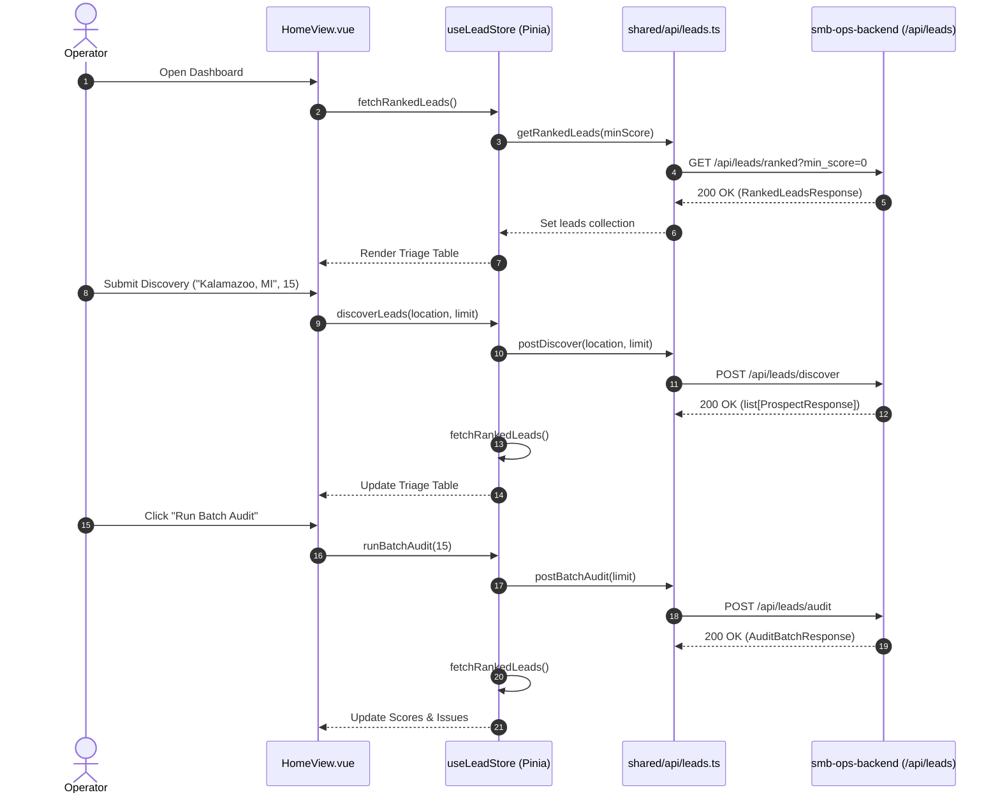

# SDD-0001: Lead Operations & Triage Dashboard Implementation

## 1. Context & Objectives
This Software Design Document specifies the architecture, component decomposition, state management, and interaction flows for the Lead Operations & Triage Dashboard in `smb-ops-frontend`.

The dashboard serves as the operational cockpit for SMB prospect discovery, technical website auditing, and opportunity scoring, consuming the REST API provided by `smb-ops-backend`.

---

## 2. System Architecture & Component Topology (FSD)

```
src/
├── shared/
│   ├── api/
│   │   ├── client.ts              # Base fetch wrapper with error handling
│   │   └── leads.ts               # Lead discovery, audit, and triage endpoints
│   └── ui/
│       ├── BaseBadge.vue          # Color-coded score/status badge
│       ├── BaseButton.vue         # Styled action button
│       ├── BaseInput.vue          # Styled form input
│       └── BaseModal.vue          # Accessible dialog overlay
│
├── entities/
│   └── lead/
│       ├── model.ts               # Prospect, AuditResult, and RankedLeadItem types
│       └── store.ts               # Pinia store managing leads, active filters, and loading states
│
├── features/
│   ├── lead-discovery/
│   │   └── DiscoveryBar.vue       # Ingress bar with location query and limit inputs
│   ├── lead-audit/
│   │   └── BatchAuditTrigger.vue  # Run batch audit across pending leads
│   ├── lead-triage/
│   │   ├── LeadTriageTable.vue    # High-density sortable triage list
│   │   ├── ScoreBadge.vue         # 0-100 score indicator with color thresholds
│   │   └── IssueChips.vue         # Critical issue chips (SSL, mobile, PDF menu, POS)
│   └── manual-lead/
│       └── CreateLeadModal.vue    # Form dialog for manual prospect ingestion
│
├── pages/
│   └── HomeView.vue               # Operations cockpit assembling features & health banner
│
└── app/
    └── router/index.ts            # Route configuration
```

---

## 3. Data Flow & Sequence Diagram



---

## 4. Detailed Component & Contract Specifications

### 4.1 Data Models (`src/entities/lead/model.ts`)
```typescript
export interface Prospect {
  id: string
  business_name: string
  website_url: string | null
  phone: string | null
  address: string | null
  source: string
  status: 'PENDING' | 'AUDITED' | 'QUALIFIED' | 'DISQUALIFIED'
  disqualification_reason: string | null
  created_at: string
  updated_at: string
}

export interface AuditResult {
  id: string
  prospect_id: string
  target_url: string
  status_code: number | null
  response_time_ms: number | null
  ssl_active: boolean
  cms_detected: string | null
  mobile_viewport_present: boolean
  menu_format: string
  pdf_menu_count: number
  pos_integrations: string[]
  tel_link_present: boolean
  critical_issues: string[]
  opportunity_score: number
  audited_at: string
}

export interface RankedLead {
  prospect: Prospect
  audit: AuditResult | null
}
```

### 4.2 State Store (`src/entities/lead/store.ts`)
* **State:**
  * `leads: RankedLead[]`
  * `minScore: number` (default 0)
  * `loading: boolean`
  * `error: string | null`
  * `statusMessage: string | null`
* **Getters:**
  * `filteredLeads`: Filtered and sorted descending by `audit.opportunity_score`.
  * `totalLeadsCount`: Count of total ingested prospects.
  * `auditedCount`: Count of leads with non-null `audit`.
  * `highPriorityCount`: Count of leads with `opportunity_score >= 70`.
* **Actions:**
  * `loadRankedLeads()`: Fetches `/api/leads/ranked`.
  * `triggerDiscovery(location: string, limit: number)`: Calls `/api/leads/discover` then refreshes triage list.
  * `triggerBatchAudit(limit: number)`: Calls `/api/leads/audit` then refreshes triage list.
  * `addManualLead(payload: CreateProspectPayload)`: Calls `POST /api/leads` then refreshes triage list.

---

## 5. Implementation Roadmap (Phases)

1. **Phase 1: Contracts & API Integration Layer**
   - Create `src/entities/lead/model.ts` with TypeScript interfaces.
   - Implement `src/shared/api/leads.ts` with typed methods for `/api/leads/*` and `/api/health`.
   - Implement `src/entities/lead/store.ts` Pinia store with unit tests in `tests/unit/lead_store.spec.ts`.

2. **Phase 2: UI Primitives & Feature Components**
   - Create UI primitives: `BaseBadge.vue`, `BaseInput.vue`, `BaseModal.vue`.
   - Build `DiscoveryBar.vue` with location input and trigger buttons.
   - Build `BatchAuditTrigger.vue` with progress state.
   - Build `CreateLeadModal.vue` with validation for manual prospect creation.

3. **Phase 3: Triage Presentation Board**
   - Build `ScoreBadge.vue` (green for <40, yellow for 40–69, red/alert for $\ge 70$ opportunity).
   - Build `IssueChips.vue` displaying SSL status, PDF menu indicators, and POS integrations.
   - Build `LeadTriageTable.vue` with responsive table layout and external linkouts.

4. **Phase 4: Page Assembly & End-to-End Verification**
   - Integrate all components into `src/pages/HomeView.vue`.
   - Run Vitest unit & component test suite (`npm run test:unit`).
   - Run linter & boundary compliance checks (`npm run lint`).
   - Verify in running polyrepo stack (`smb-ops-stack`) with real API responses.
