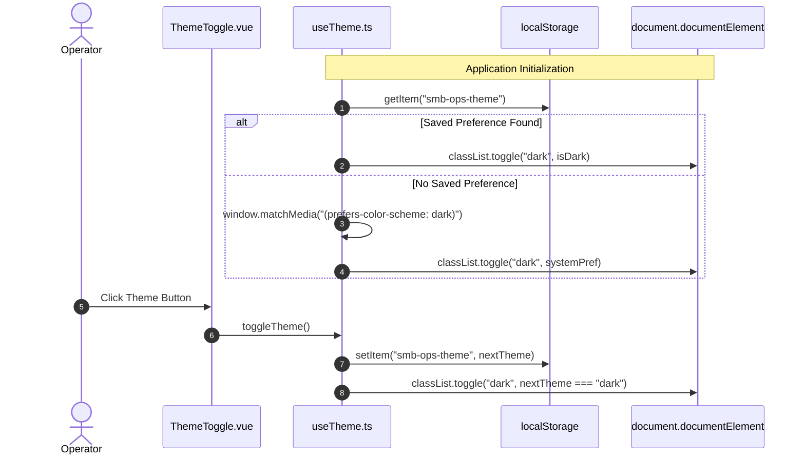

# SDD-0002: Dark Mode Theming System and Token Specification

## 1. System Overview
This Software Design Document specifies the design token hierarchy, reactivity model, and component integration for dark mode theming in `smb-ops-frontend`.

The theming subsystem allows operators to toggle between light and dark palettes with instant visual updates, persisted preferences in `localStorage`, and automated fallback to system OS `prefers-color-scheme`.

---

## 2. Token Architecture (`src/shared/styles/theme.css`)

### 2.1 Design Tokens Contract
The system introduces semantic tokens bound to `:root` (default light) and `:root.dark`:

| Token Name | Light Palette | Dark Palette | Semantic Purpose |
| :--- | :--- | :--- | :--- |
| `--bg-app` | `#f9fafb` | `#0f172a` (Slate 900) | Root application background |
| `--bg-surface` | `#ffffff` | `#1e293b` (Slate 800) | Card, modal, and table container surface |
| `--bg-surface-hover` | `#f8fafc` | `#334155` (Slate 700) | Row hover and interactive component surface |
| `--bg-surface-subtle` | `#f3f4f6` | `#1e293b` | Form input backgrounds and disabled states |
| `--border-color` | `#e5e7eb` | `#334155` (Slate 700) | Primary structural borders |
| `--border-subtle` | `#f3f4f6` | `#1e293b` | Inner table dividing lines |
| `--text-primary` | `#111827` | `#f8fafc` (Slate 50) | High-contrast body and heading text |
| `--text-secondary` | `#4b5563` | `#94a3b8` (Slate 400) | Subtitles, labels, and secondary metadata |
| `--text-muted` | `#9ca3af` | `#64748b` (Slate 500) | Timestamps, empty states, and muted hints |
| `--accent-primary` | `#3b82f6` | `#3b82f6` | Brand and action button backgrounds |
| `--accent-hover` | `#2563eb` | `#60a5fa` | Hover action highlights |
| `--metric-alert-bg` | `#fffaf0` | `#2d1a1a` | High-priority metric alert card background |
| `--metric-alert-border`| `#fecaca` | `#7f1d1d` | High-priority metric alert border |
| `--metric-alert-text` | `#b91c1c` | `#f87171` | High-priority metric alert numbers |

---

## 3. Reactive State Architecture (`src/shared/composables/useTheme.ts`)



### 3.1 Interface Contract
```typescript
export type ThemeMode = 'light' | 'dark'

export interface ThemeComposable {
  theme: Ref<ThemeMode>
  isDark: ComputedRef<boolean>
  toggleTheme: () => void
  setTheme: (mode: ThemeMode) => void
}
```

---

## 4. Component Refactoring Matrix

1. **`App.vue`:**
   - Imports `src/shared/styles/theme.css`.
   - Global `body` styling bound to `var(--bg-app)` and `var(--text-primary)`.
2. **`shared/ui/BaseInput.vue`:**
   - Input background bound to `var(--bg-surface)` or `var(--bg-surface-subtle)`.
   - Text color bound to `var(--text-primary)`.
   - Border bound to `var(--border-color)`.
3. **`shared/ui/BaseModal.vue`:**
   - Backdrop: `rgba(0, 0, 0, 0.7)`.
   - Modal card: `var(--bg-surface)` with `var(--border-color)`.
   - Header & Footer: `var(--bg-surface-hover)` with `var(--border-color)`.
4. **`shared/ui/ThemeToggle.vue`:**
   - Accessible button with Sun / Moon iconography.
   - Smooth hover states utilizing `var(--bg-surface-hover)`.
5. **`features/lead-discovery/DiscoveryBar.vue`:**
   - Container background: `var(--bg-surface)`.
   - Border: `var(--border-color)`.
6. **`features/lead-triage/LeadTriageTable.vue`:**
   - Table wrapper background: `var(--bg-surface)`.
   - Table header row: `var(--bg-surface-hover)` with text `var(--text-secondary)`.
   - Lead row hover state: `var(--bg-surface-hover)`.
   - Sub-details and external links: `var(--text-muted)` and `var(--accent-hover)`.
7. **`pages/HomeView.vue`:**
   - Header contains `ThemeToggle`.
   - Metric cards bind to `var(--bg-surface)` and `var(--border-color)`.
   - Filter dropdowns bind to `var(--bg-surface)` and `var(--text-primary)`.

---

## 5. Verification & Quality Gates
* **Unit Tests (`tests/unit/useTheme.spec.ts`):** Verify `toggleTheme`, `localStorage` read/write, and DOM `classList` mutation.
* **Component Tests (`tests/unit/ThemeToggle.spec.ts`):** Verify click events invoke theme transitions.
* **Static Analysis:** Zero ESLint or TypeScript errors (`pnpm lint`, `pnpm type-check`).
* **Visual Verification:** Stack validation in browser on `http://localhost:8090`.
