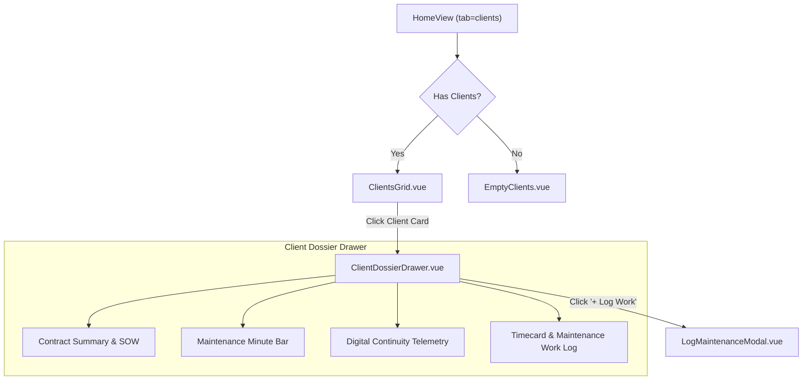
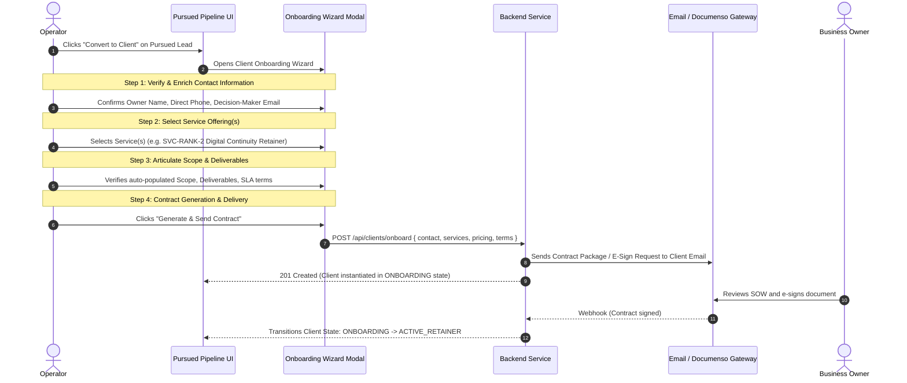
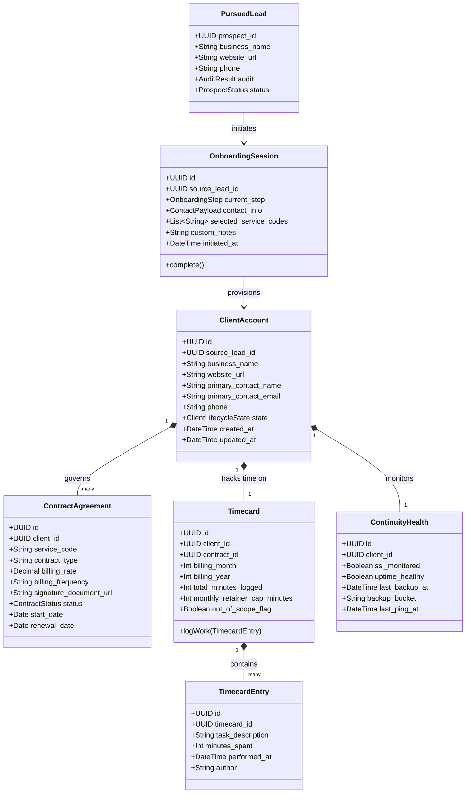

# 0003: Client Accounts Workspace and Dossier Design

## 1. Executive Summary

This Software Design Document details the UI components, Feature-Sliced Design (FSD) structure, and interaction patterns for the **Client Accounts Workspace** (`tab=clients`) and the integrated **Client Onboarding Pipeline** in `smb-ops-frontend`.

---

## 2. Client Onboarding Pipeline Workflow

Promoting a Pursued Lead into a contracted Client Account initiates the structured **Client Onboarding Pipeline**.

---

## 3. Onboarding & Client Architecture Class Diagram

---

## 4. Industry Reference Analysis: Client Onboarding & Dashboards

### 4.1 Common Workflows in Leading Client Dashboards
* **Agencies & Managed Services (e.g. HubSpot, Productive, ManyRequests):**
  * **Intake & Scope Confirmation:** Pre-populating verified prospect technical audit data (missing SSL, slow TTFB, PDF menu problems) directly into the client dossier.
  * **Contract & Scope Governance:** Explicitly itemizing deliverables and exclusions in the contract summary so client requests exceeding scope can be flagged transparently.
  * **Timecard & Retainer Consumption:** Real-time visibility into support time (e.g., 30-minute monthly maintenance limit) preventing profit margin leakage.
  * **Continuity & SLA Status:** Single-pane-of-glass status indicator showing uptime and backup health for all active client domains.

### 4.2 Application to Small Business Operations Stack
* **Onboarding Wizard:** Instead of an instant, bare-bones database insert, clicking "Convert to Client" opens a focused 4-step wizard:
  1. **Contact Verification:** Confirm owner name, email, phone, and billing address.
  2. **Service Package Selection:** Select from registered Service Catalog tiers (e.g. `SVC-RANK-1A`, `SVC-RANK-2`).
  3. **Work Scope & Terms:** Review deliverables, standard SLA support hours (Mon-Fri 9-5 EST), and emergency response limits.
  4. **Contract Dispatch:** Generate contract and dispatch to client for review and signature (via email or Documenso/Dropbox Sign).
* **Future Timecard Integration:**
  * When a client account is created, a default `Timecard` is provisioned for the current billing cycle.
  * Operators log ad-hoc client requests against specific contracts, tracking work against the 30-minute retainer boundary.

---

## 5. Component Hierarchy & FSD Slices

* **`widgets/client-accounts/`**:
  * `ClientsGrid.vue`: Responsive CSS grid hosting individual client cards.
  * `ClientCard.vue`: Card displaying business name, primary contact, contract type badge, and continuity status.
* **`features/client-onboarding/`**:
  * `ClientOnboardingModal.vue`: Multi-step onboarding pipeline wizard (Contact -> Services -> Scope -> Contract Dispatch).
* **`features/client-dossier/`**:
  * `ClientDossierDrawer.vue`: Side drawer providing deep inspection of contracts, billing rate, signed document links, timecards, and maintenance entries.
* **`features/client-maintenance/`**:
  * `LogMaintenanceModal.vue`: Modal allowing operators to log minutes spent and task description against the client's timecard.
  * `MaintenanceGauge.vue`: Progress indicator displaying used minutes vs remaining monthly allowance.
* **`entities/client/`**:
  * `model.ts`: TypeScript contracts for `ClientAccount`, `ContractAgreement`, `Timecard`, `TimecardEntry`, `ContinuityHealth`.
  * `store.ts`: Pinia client store managing state, API queries, and onboarding mutations.

---

## 6. Visual & Interaction Design Specifications

### 6.1 Maintenance Gauge Invariant
* Under 25 minutes: Green progress bar (`var(--color-success)`).
* 25–30 minutes: Amber warning progress bar (`var(--color-warning)`).
* >30 minutes: Red overflow progress bar (`var(--color-danger)`) with badge: `Out-of-Scope (Additional SOW Required)`.

### 6.2 Continuity Health Indicator
* `All Systems Green`: Active SSL, successful weekly S3 backup within last 7 days, uptime check passing.
* `Warning`: Overdue backup (>7 days) or SSL expiring within 14 days.
* `Critical`: Website endpoint offline / HTTP error.
