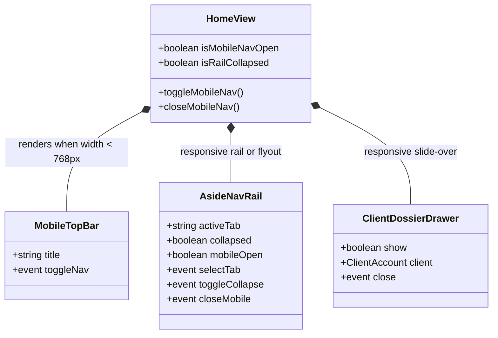
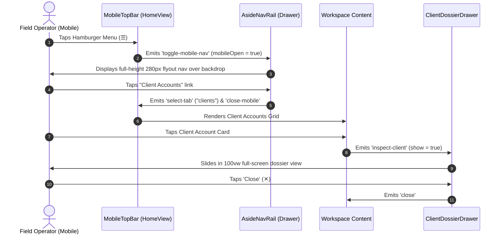

# SDD-0004: Mobile and Responsive Viewport Adaptation Design

## 1. Executive Summary & Skeptic Justification

As field operations scale, operators evaluate and triage leads, inspect client telemetry, and record maintenance hours directly on mobile phones and tablets at client physical locations or on transit. Currently, the dashboard desktop layout hardcodes a 240px wide sidebar and a 540px drawer, making mobile usage non-viable.

Building separate mobile endpoints would introduce code drift and maintenance overhead. This design achieves complete mobile ergonomics by adapting existing Feature-Sliced Design components via responsive CSS custom properties, an off-canvas mobile flyout drawer, and collapsible icon-rail states.

## 2. Structural Component Model

## 3. Dynamic Interaction Flow

## 4. Phased Implementation Plan & Verification

* **Phase 1: `AsideNavRail.vue` Responsiveness & Icon Collapse:**
  * Add `collapsed` prop and local toggle to support compact 64px icon-only rail.
  * Add mobile flyout drawer mode with backdrop overlay.
* **Phase 2: `HomeView.vue` Top Mobile App Bar:**
  * Render a sticky mobile header bar with hamburger button `☰`, title, and ThemeToggle when `max-width: 768px`.
* **Phase 3: `ClientDossierDrawer.vue` Mobile Layout:**
  * Adjust `.dossier-drawer` to `width: 100vw; max-width: 100%` on mobile.
  * Stack telemetry items and action buttons vertically with touch padding.
* **Phase 4: Workspace Grids & Tables Touch Ergonomics:**
  * Ensure horizontal scrolling wrappers on `LeadTriageTable.vue` and wrapping grids on `ClientsGrid` / `pipeline-grid`.
