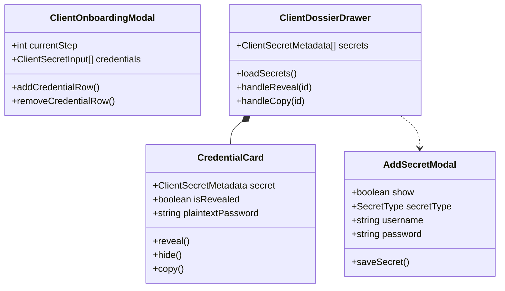

# SDD-0005: Client Credential Vault UI Design

## 1. Executive Summary & Skeptic Justification

Storing client website credentials insecurely in shared files or unencrypted notes creates severe risk of data compromise. This design integrates zero-knowledge credential ingestion into the client onboarding wizard and provides an in-dossier credential vault with automatic masked redaction and audited one-touch reveal timers.

## 2. Structural Component Model



## 3. Dynamic Interaction Flow

```mermaid
sequenceDiagram
    autonumber
    actor Operator
    participant Drawer as ClientDossierDrawer
    participant Card as CredentialCard
    participant Store as LeadStore (Pinia)
    participant API as Backend REST API

    Operator->>Drawer: Opens Client Dossier
    Drawer->>Store: getClientSecrets(client.id)
    Store->>API: GET /api/clients/:id/secrets
    API-->>Store: SecretMetadata[] (id, type, label, username, masked=true)
    Store-->>Drawer: Populates secrets list
    Drawer->>Card: Renders CredentialCard (Password: ••••••••)

    Operator->>Card: Clicks "Reveal Password" (👁️)
    Card->>Store: revealClientSecret(client.id, secret.id)
    Store->>API: POST /api/clients/:id/secrets/:id/reveal
    API-->>Store: { plaintext: "DecryptedSecret123!" }
    Store-->>Card: Returns plaintext string
    Card->>Card: Sets timer (auto-hide in 30s)
    Card->>Operator: Displays plaintext password with countdown badge

    Note over Card,Operator: 30 seconds elapse or Operator clicks Hide (👁️‍🗨️)
    Card->>Card: Clears plaintext string; resets to ••••••••
```

## 4. Phased Implementation Plan & Verification

* **Phase 1: Pinia Store & TypeScript Definitions:**
  * Add `SecretType`, `ClientSecretMetadata`, and `ClientSecretPayload` to `@/shared/types/lead.ts`.
  * Implement `getClientSecrets`, `revealClientSecret`, `storeClientSecret`, and `deleteClientSecret` in `@/entities/lead/store.ts`.
* **Phase 2: Onboarding Wizard Step 4 Integration:**
  * Add "Credentials & Access" step in `ClientOnboardingModal.vue`.
  * Pass captured credential payloads in the onboarding submission payload.
* **Phase 3: Dossier Drawer Vault Section & Reveal Ergonomics:**
  * Implement "Credentials & Access Vault" section in `ClientDossierDrawer.vue`.
  * Implement masked-by-default cards with 30s reveal timer and transient clipboard copy.
