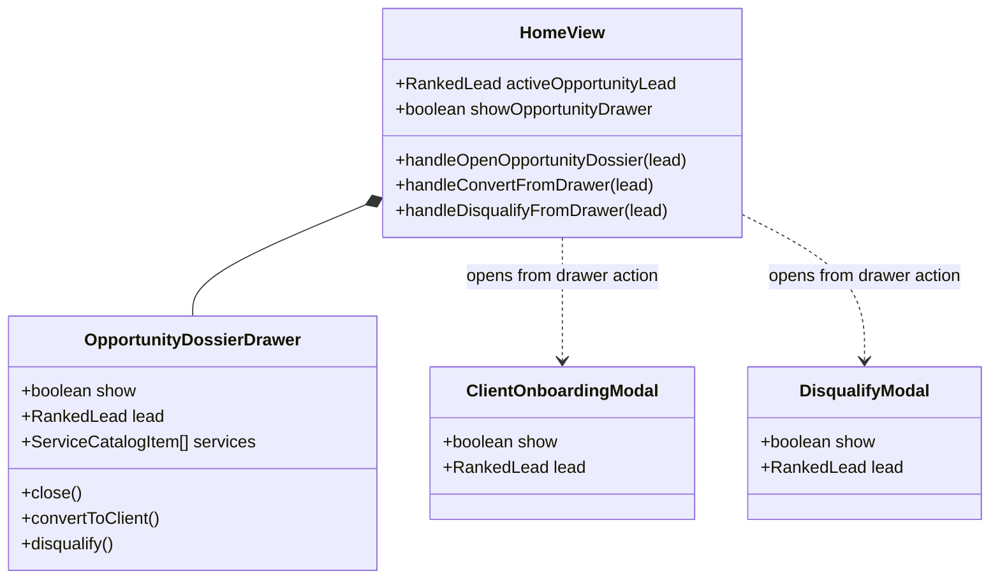
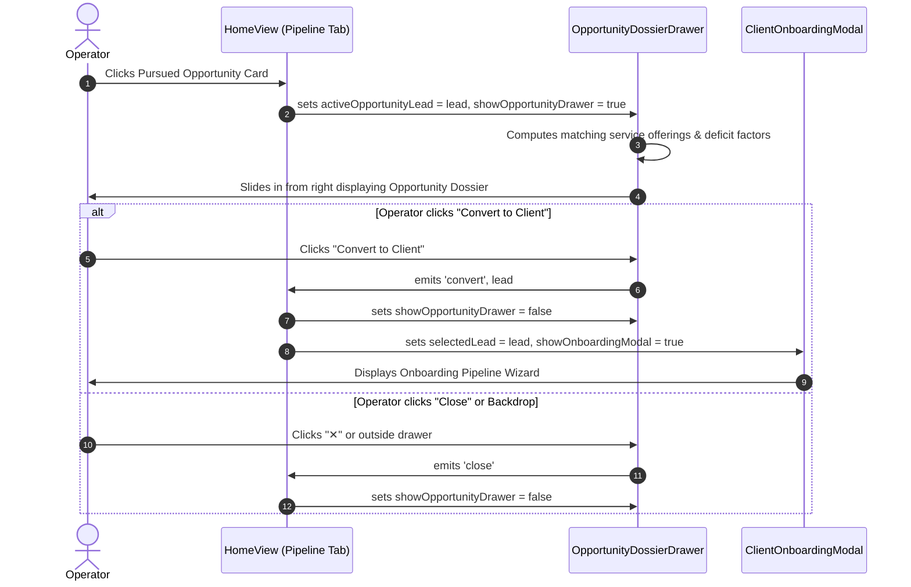

# SDD-0006: Pursued Opportunity Dossier Drawer Design

## 1. Executive Summary & Skeptic Justification

In the **Pursued Pipeline**, operators frequently inspect claimed business opportunities to review contact info, evaluate why a prospect received high opportunity scores, and select matching service packages. Replacing modal popups with a persistent right-aligned slide drawer matches the operator ergonomics established in the Client Accounts workspace.

## 2. Structural Component Model

## 3. Dynamic Interaction Flow

## 4. Layout Specifications

* **Drawer Container:** Identical CSS structure to `ClientDossierDrawer` (`.drawer-overlay`, `.dossier-drawer`, `.drawer-header`, `.drawer-body`).
* **Header:** Tracking UID badge (`UID: 8-char`), business name, status badge (`PURSUED`), close button (`✕`).
* **Section 1 (Business Profile):** Website link, direct phone, geographic address.
* **Section 2 (Opportunity Score Card):** Calculated score (0-100), audit timestamp, deficit bullet points (+25 SSL, +30 unreadable PDF menus, etc.).
* **Section 3 (Best-Fit Service Offerings):** Matched service offerings with pricing badges, scope preview, and minimum score indicators.
* **Footer Action Bar:** Prominent "Convert to Client" (primary) and "Disqualify Lead" (danger).
