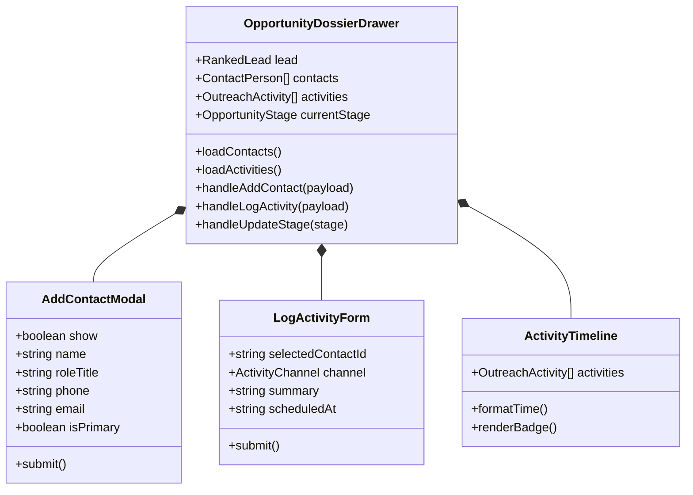

# SDD-0007: Opportunity Contacts and Activity Ledger UI Design

## 1. Executive Summary & Skeptic Justification

Sales conversion requires multiple touches with multiple people inside an organization. This design implements contacts management, interaction tracking, appointment scheduling, and stage progression directly within `OpportunityDossierDrawer.vue`.

## 2. Component Architecture



## 3. Interaction Sequence

```mermaid
sequenceDiagram
    autonumber
    actor Operator
    participant Drawer as OpportunityDossierDrawer
    participant Store as LeadStore (Pinia)
    participant API as Backend REST API

    Operator->>Drawer: Opens Opportunity Dossier
    Drawer->>Store: fetchOpportunityContacts(lead.id)
    Drawer->>Store: fetchOpportunityActivities(lead.id)
    API-->>Store: Returns contacts & activities
    Store-->>Drawer: Populates Contacts Directory & Activity Timeline

    Operator->>Drawer: Fills "Log Touchpoint / Schedule Appointment"
    Note over Operator,Drawer: Selects contact, chooses "APPOINTMENT", sets datetime
    Operator->>Drawer: Clicks "Record Activity"
    Drawer->>Store: logOpportunityActivity(lead.id, payload)
    Store->>API: POST /api/leads/:id/activities
    API-->>Store: Created Activity (+ auto-updates stage to APPOINTMENT_SCHEDULED)
    Store-->>Drawer: Appends activity; updates stage pill-bar
```
