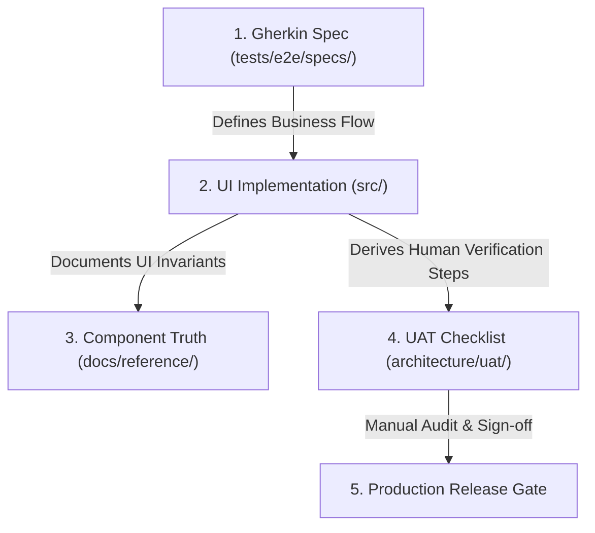

# Software Design Document: UAT Lifecycle, Gherkin Specification Pipeline, and Design System Reference

## 1. System Overview
This document specifies the end-to-end testing and documentation pipeline in `smb-ops-frontend`. It bridges business requirements, automated behavioral specs, human user-acceptance testing (UAT), and visual component documentation.

## 2. Directory Topology & Architectural Boundaries

```
smb-ops-frontend/
├── architecture/
│   └── uat/                                    <── Unified Process Test Discipline (Engineering Plane)
│       ├── README.md                           <── Governance & Authoring Manual
│       └── [ID]_[feature]_uat_plan.md          <── Pass/Fail human release audit documents
├── docs/
│   └── reference/                              <── Diataxis Framework (Operator / Customer Plane)
│       ├── README.md                           <── Component Cheat Sheet Guidelines
│       └── ui_components.md                    <── Visual & Behavioral Component Catalog
├── tests/
│   └── e2e/
│       └── specs/                              <── Executable Business Behaviors
│           └── [feature].feature               <── Gherkin Scenarios (Given/When/Then)
└── .github/
    └── workflows/
        └── ci.yml                              <── Automated CI Verification Gate
```

## 3. Four-Phase Authoring Sequence



1. **Step 1: Behavioral Scenario (`tests/e2e/specs/*.feature`)**
   - Author plain-language Gherkin scenarios before coding UI components.
   - Eliminates ambiguity regarding user inputs, state transitions, and business rules.
2. **Step 2: Component Implementation & Cataloging (`docs/reference/ui_components.md`)**
   - Implement the Vue 3 component in `src/shared/ui/` or `src/features/`.
   - Update the Component Reference with visual tokens, states (default, hover, active, disabled, loading), and behavior rules.
3. **Step 3: UAT Release Document Generation (`architecture/uat/*.md`)**
   - Author a numbered, click-by-click checklist covering primary and edge flows.
   - Provide explicit expected results, form field inputs, and Markdown checkboxes (`[ ]`).
4. **Step 4: Manual Run & CI Sign-off**
   - Execute the UAT pass on the staging/development deployment.
   - Commit the completed checklist (`[x]`) with tester name, timestamp, and verification evidence.

## 4. Gherkin Tooling & Pipeline Architecture

- **Format:** Gherkin v3 syntax (`Feature`, `Background`, `Scenario`, `Given`, `When`, `Then`, `And`).
- **Linter:** `gherkin-lint` configured via `.gherkin-lintrc`.
  - Rules enforced: `no-empty-file`, `no-duplicate-scenario-names`, `scenario-outlines-must-have-examples`, `indentation`.
- **Pre-Commit & CI:** Automated `pnpm run lint:gherkin` and Markdown frontmatter validation in GitHub Actions.
