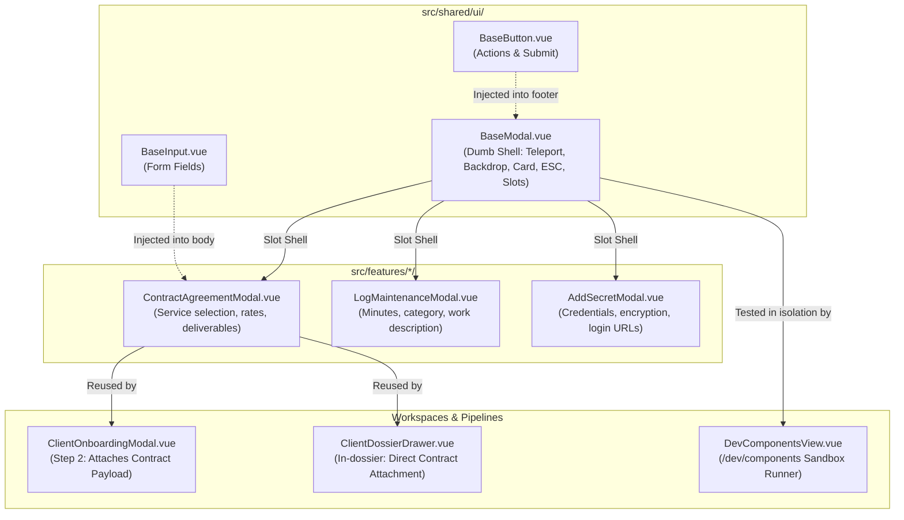

# Software Design Document: BaseModal Architecture, Dev Workbench (/dev/components), and Feature Modal Specification

## 1. System Overview
This Software Design Document specifies the architecture, component composition, routing, and testing lifecycle for `BaseModal.vue`, the `/dev/components` developer workbench, and domain feature modals (e.g. `ContractAgreementModal.vue`).

---

## 2. Component Composition Hierarchy



---

## 3. Developer Component Workbench Route (`/dev/components`)

### 3.1 Routing Specification
* **Path:** `/dev/components`
* **Route Name:** `dev-components`
* **Component:** `src/pages/DevComponentsView.vue`
* **Environment Gate:** Active across development and staging environments.

### 3.2 Workbench Interactive Test Harness
The `/dev/components` page provides live interactive sections:
1. **Modal Sandbox:**
   - Button to trigger `BaseModal` with standard title, body paragraphs, and action footer.
   - Verifies backdrop dismissal, `✕` close trigger, `Escape` key capture, and background body scroll locking.
2. **Button Matrix:**
   - Renders all `BaseButton` variants (`primary`, `secondary`, `danger`) across states (`default`, `loading`, `disabled`, `submit`).
3. **Badge Matrix:**
   - Renders all `BaseBadge` color tokens (`emerald`, `amber`, `rose`, `indigo`, `slate`).
4. **Maintenance Gauge Simulator:**
   - Sliders to dynamically adjust logged minutes vs. monthly cap minutes to inspect green ($\le 75\%$), amber ($76\%-100\%$), rose ($>100\%$), and 0-cap neutral states.

---

## 4. Feature Modal Composition Pattern: `ContractAgreementModal`

### 4.1 Component Contract
Feature modals wrap `BaseModal` and handle all business logic, exposing a dual-mode interface:

```typescript
interface ContractAgreementModalProps {
  show: boolean
  clientId?: string // Present in Client Account mode; absent in Onboarding mode
  initialServiceCode?: string
}

interface ContractAgreementModalEmits {
  (e: 'close'): void
  (e: 'save', payload: AttachContractPayload): void
}
```

### 4.2 Standard Template Pattern

```html
<template>
  <BaseModal :show="show" :title="modalTitle" @close="$emit('close')">
    <form @submit.prevent="handleSubmit">
      <div class="space-y-4">
        <!-- Service Offering Selection -->
        <div class="form-group">
          <label class="form-label">Service Offering *</label>
          <select v-model="selectedServiceCode" class="custom-select" required>
            <option v-for="s in availableServices" :key="s.code" :value="s.code">
              {{ s.name }} (${{ s.price_min }}/mo)
            </option>
          </select>
        </div>

        <!-- Single Price Input -->
        <div class="form-group">
          <label class="form-label">Agreed Monthly Rate ($) *</label>
          <BaseInput v-model.number="billingRate" type="number" min="0" required />
        </div>

        <!-- Deliverables Checklist Preview -->
        <div class="deliverables-preview">
          <h5>Contracted Deliverables Scope</h5>
          <ul>
            <li v-for="(del, idx) in previewDeliverables" :key="idx">{{ del }}</li>
          </ul>
        </div>
      </div>

      <template #footer>
        <div class="modal-actions">
          <BaseButton label="Cancel" variant="secondary" @click="$emit('close')" />
          <BaseButton label="Confirm Contract" button-type="submit" :loading="isSaving" />
        </div>
      </template>
    </form>
  </BaseModal>
</template>
```

---

## 5. Testing & Verification Requirements

### 5.1 BaseModal Unit Testing Matrix (`tests/unit/BaseModal.spec.ts`)
* **Test 1:** Does not render in DOM when `show: false`.
* **Test 2:** Renders card, title, and slot content when `show: true`.
* **Test 3:** Emits `@close` event on close button (`✕`) click.
* **Test 4:** Emits `@close` event on backdrop click.
* **Test 5:** Emits `@close` event when `Escape` key is triggered on `window`.
* **Test 6:** Does NOT emit `@close` when inner modal card is clicked (event propagation stopped).

### 5.2 Feature Modal Gherkin Specification Template
When authoring business workflows for feature modals, specify Gherkin scenarios in `tests/e2e/specs/` following this template:

```gherkin
Feature: [Feature Name] Modal Workflow
  As an SMB operator
  I want to [trigger action and fill modal form]
  So that [entity state is updated]

  Scenario: Successfully submit [Feature Name] modal
    Given the operator is viewing the [workspace name]
    When the operator clicks "[Modal Trigger Button Label]"
    Then the "[Modal Title]" modal opens
    When the operator enters "[Field 1]" with "[Value 1]"
    And selects "[Field 2]" with "[Value 2]"
    And clicks "[Submit Button Label]"
    Then the modal closes
    And the new [entity] is visible in the [table/grid] with status "[Status]"

  Scenario: Dismiss [Feature Name] modal without saving
    Given the "[Modal Title]" modal is open
    When the operator clicks "Cancel"
    Then the modal closes
    And no new [entity] is created
```
