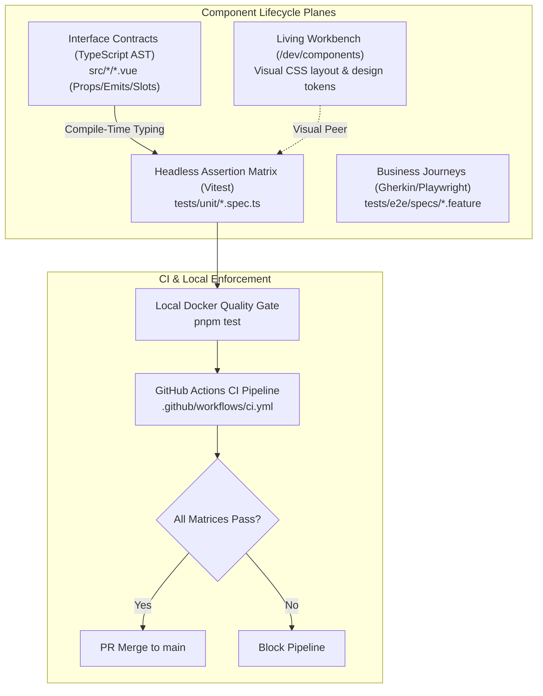

# Software Design Document: Headless Assertion Matrix in Vitest Specification & Enforcement

## 1. System Overview & Testing Architecture

This Software Design Document specifies the architecture, invariant classification, authoring procedure, and CI/pre-commit enforcement mechanisms for the **Headless Assertion Matrix in Vitest** (`tests/unit/*.spec.ts`) across `smb-ops-frontend`.



---

## 2. Component Archetypes & Invariant Requirements

Assertion matrices vary based on component architectural responsibility:

| Component Archetype | Canonical Examples | Required Invariant Focus | Anti-Patterns to Avoid |
| :--- | :--- | :--- | :--- |
| **Primitives** | `BaseButton`, `BaseBadge`, `BaseInput` | Prop-to-class binding, event emitting, native attributes (`disabled`, `type`), error messaging. | Asserting pixel margins, exact CSS colors, or container flex direction. |
| **Structural Shells & Modals** | `BaseModal` | `<Teleport>` to `<body>`, body scroll lock, Escape key interception, backdrop vs card click propagation. | Asserting inner child business logic or backdrop blur values. |
| **Selection & Telemetry** | `MaintenanceGauge`, `ServiceFilterDropdown` | Threshold calculation, outside click popover toggle, immutability of selection arrays. | Full browser rendering of SVG progress geometry. |
| **Transactional Feature Modals** | `ContractAgreementModal`, `LogWorkModal`, `VaultSecretModal` | Form validation suppression, typed payload structure on `@save`, form reset on close. | Testing backend API endpoints or cross-feature side effects. |

---

## 3. Invariant Taxonomy & Test Structure

Every test file follows a standardized naming and structural hierarchy:

```typescript
import { describe, it, expect, beforeEach, afterEach } from 'vitest'
import { mount } from '@vue/test-utils'
import TargetComponent from '@/path/to/TargetComponent.vue'

describe('<TargetComponent> Component Matrix', () => {
  beforeEach(() => {
    // Reset global DOM state for Teleport and body styles
    document.body.innerHTML = ''
    document.body.style.overflow = ''
  })

  // Tier 1: DOM Lifecycle Invariants
  it('Invariant 1: Conditional rendering and teleport attachment', () => { ... })

  // Tier 2: Prop Reflection & Attributes
  it('Invariant 2: Binds native attributes and semantic classes based on props', () => { ... })

  // Tier 3: Event Emission & Payload Integrity
  it('Invariant 3: Emits typed event with validated payload structure on action', async () => { ... })

  // Tier 4: Keyboard & Ergonomics
  it('Invariant 4: Intercepts keyboard events and maintains focus or locks', async () => { ... })

  // Tier 5: Boundary & Error Suppression
  it('Invariant 5: Suppresses actions when disabled or loading', async () => { ... })
})
```

---

## 4. Pipeline Enforcement Specification

### 4.1 GitHub Actions Workflow Gate
In `.github/workflows/ci.yml`, the `Run Unit & Architectural Tests` step runs directly before `Production Build Verification`:

```yaml
- name: "Run Unit & Architectural Tests"
  run: "pnpm run test"
```

Failure of any unit test matrix returns an exit code of `1`, immediately terminating the CI run and blocking PR merge.

### 4.2 Local Pre-Commit & PR Quality Gate
Per repository governance, all changes must pass unit tests in the container before opening a PR:

```bash
docker run --rm -v $(pwd):/app -w /app node:20-alpine sh -c "corepack enable && pnpm test"
```

---

## 5. Implementation Roadmap

1. **Phase 1 (Governance):** Author ADR-0029 and SDD-0012 (Completed).
2. **Phase 2 (Reference Documentation):** Author `docs/reference/headless_assertion_matrix_procedure.md` with comprehensive guidelines and archetype code samples.
3. **Phase 3 (Enforcement Verification):** Verify 100% compliance across all existing unit test files in `tests/unit/`.
