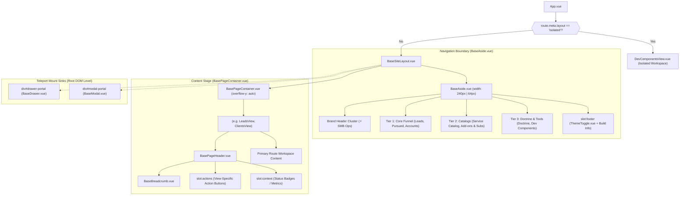

# SDD-0014: Base Site Shell Layout and Topology Specification

## 1. Visual Topology & Spatial Architecture

The application adopts a deterministic two-zone spatial topology operating within a fixed `100vw x 100vh` root viewport:
1. **Left Navigation Boundary:** A full-height, continuous vertical rail (`BaseAside.vue`) spanning `100vh` with data-driven 3-tier navigation sections and collapsed state persistence.
2. **Right Stage Viewport:** A full-height scrollable content canvas (`BasePageContainer.vue`) hosting top-level route views, standard orientation headers (`BasePageHeader.vue`), and child workspaces.
3. **Portal Mounting Roots:** Global teleport sinks mounted outside the main document flow directly beneath `<body>` for non-clipping modal dialogs and flyout drawers.

```
+===================================================================================================================+
|                                           VIEWPORT (100vw x 100vh)                                                |
+=============================================+=====================================================================+
|  LEFT NAV RAIL (BaseAside.vue)              |  MAIN STAGE VIEWPORT (BasePageContainer.vue)                        |
|  [width: 240px (expanded) / 64px (rail)]    |  [flex: 1, height: 100%, overflow-y: auto, max-width: 1280px/fluid] |
|                                             |                                                                     |
|  * HEADER CLUSTER:                          |  * PAGE ORIENTATION (BasePageHeader.vue):                           |
|    - Brand Logo: ⚡                         |    - Breadcrumb Trail: BaseBreadcrumb.vue [Home / Section / Node]   |
|    - Brand Title: "SMB Ops"                 |    - Title Cluster: Page Title (h1) + Subtitle                      |
|    - Brand Subtitle: "Practice Engine"      |    - Context Badges / Primary View Actions (Slotted per route)      |
|    - Collapse/Expand Toggle (◀ / ▶)         |                                                                     |
|                                             |  * ACTIVE ROUTE WORKSPACE (<RouterView />):                         |
|  * 3-TIER NAVIGATION SPINE:                 |    - Route-specific components (tables, KPI cards, forms, gauges)   |
|    [Tier 1: Core Funnel]                    |    - Clean vertical rhythm (padding: 2rem 1.5rem desktop)           |
|      - [icon] Leads (/leads) [Count]        |                                                                     |
|      - [icon] Pursued (/pursued) [Count]    |                                                                     |
|      - [icon] Accounts (/clients) [Count]   |                                                                     |
|    [Tier 2: Catalogs]                       |                                                                     |
|      - [icon] Service Catalog (/services)   |                                                                     |
|      - [icon] Add-ons & Subs (/addons)      |                                                                     |
|    [Tier 3: Doctrine & Operations]           |                                                                     |
|      - [icon] Business Doctrine (/doctrine) |                                                                     |
|                                             |                                                                     |
|  * FOOTER CLUSTER:                          |                                                                     |
|    - Version Tag: "v1.2.0 • Active"         |                                                                     |
|    - ThemeToggle.vue (☀️ / 🌙)              |                                                                     |
+=============================================+=====================================================================+
|  OVERLAY MOUNTING ROOTS (Teleport targets rendered directly under <body>)                                          |
|  - <div id="drawer-portal" /> (BaseDrawer.vue — sm: 420px, md: 680px, lg: 960px, full: 100%)                       |
|  - <div id="modal-portal" /> (BaseModal.vue — blocking confirmation & dialog flows)                                |
+===================================================================================================================+
```

> [!NOTE]
> **Dev Isolation Invariant:** Development routes (`/dev/components`) are marked with `meta: { layout: 'isolated' }` and completely bypass `BaseSiteLayout`. They render as an independent sandbox without application aside, header, or operational telemetry.

---

## 2. Component Hierarchy Tree



---

## 3. Responsive Breakpoint Rules

| Viewport Tier | Width Range | Navigation Behavior | Stage Canvas Rhythms | Header Layout |
| :--- | :--- | :--- | :--- | :--- |
| **Desktop** | &ge; 1024px | Full 240px expanded rail. Collapse toggle (◀) optional by operator. | Max-width 1280px (or fluid); padding `2rem 1.5rem`. | Horizontal row: Title on left, actions on right. |
| **Tablet** | 768px &ndash; 1023px | Default to 64px collapsed icon rail. Hover popover tooltips active. | Max-width 100%; padding `1.5rem 1rem`. | Horizontal row with flex-wrap. |
| **Mobile** | &lt; 768px | Left rail hidden off-canvas. Top mobile header (56px) with hamburger toggle; aside slides in as modal sheet with backdrop. | Max-width 100%; padding `1rem 0.75rem`. | Vertical stack: Title above action buttons; full-width buttons. |

---

## 4. Navigation Taxonomy & Data-Driven Schema

The navigation rail is declared data-driven via `NavSectionDef[]`:

```typescript
export interface NavItemDef {
  id: string
  label: string
  icon: string
  to?: string
  badge?: number | string
  badgeVariant?: 'neutral' | 'primary' | 'success' | 'warning' | 'danger' | 'emerald'
}

export interface NavSectionDef {
  id: string
  tier: 'primary' | 'secondary' | 'tertiary'
  title?: string
  items: NavItemDef[]
}
```

### Route Allocation Matrix

| Tier | Route ID | Route Path | Display Label | Icon | Live Badge Source |
| :--- | :--- | :--- | :--- | :--- | :--- |
| **Primary** | `leads` | `/leads` (or `/`) | Leads (Discovery) | 🔍 | `leadStore.poolCount` (`badge-primary`) |
| **Primary** | `pursued` | `/pursued` | Pursued Pipeline | 🎯 | `leadStore.pursuedCount` (`badge-warning`) |
| **Primary** | `accounts` | `/clients` | Client Accounts | 💼 | `leadStore.clientsCount` (`badge-emerald`) |
| **Secondary** | `services` | `/services` | Service Catalog | 📋 | None |
| **Secondary** | `addons` | `/addons` | Add-ons & Subs | 📦 | None |
| **Tertiary** | `doctrine` | `/doctrine` | Business Doctrine | 📖 | None |

---

## 5. Portal & Overlay Mounting Standards

To guarantee overlay z-index stacking and prevent layout clipping (`overflow: hidden` or `transform` parent context traps):

1. **`#drawer-portal`:**
   * Used exclusively by `BaseDrawer.vue`.
   * Stacks at `z-index: 900`.
   * Slides in from right screen edge, stopping flush against the rail margin on desktop.
2. **`#modal-portal`:**
   * Used exclusively by `BaseModal.vue`.
   * Stacks at `z-index: 1000`.
   * Centered dialog backdrop locking document scrolling.

---

## 6. CSS Design Token Governance

All base site shell components strictly consume root design tokens defined in `src/shared/styles/theme.css`:
* **Surfaces:** `var(--bg-app)` for root viewport and page background; `var(--bg-surface)` for rail and cards; `var(--bg-surface-subtle)` for collapsed expand strip.
* **Borders:** `var(--border-color)` for rail boundary and header separators.
* **Typography:** `var(--font-sans)` for UI labels; `var(--text-primary)`, `var(--text-secondary)`, `var(--text-muted)`.
* **Brand:** `var(--accent-primary)` (#3b82f6) for brand icon and active primary route pills.
