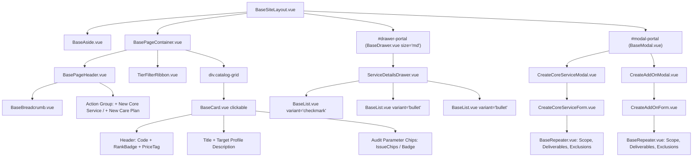

# SDD-0015: Service Catalog Workspace Layout and Topology Specification

## 1. Visual Topology & Spatial Architecture

The Service Catalog Workspace (`ServiceCatalogView.vue`) resides within the application shell (`BaseSiteLayout.vue`) mounted inside the stage canvas (`BasePageContainer.vue`). It delivers high-density catalog exploration, 4-tier commercial categorization, and administrative ingestion through two contextual portals:
1. **Header Orientation Strip:** Slotted `BasePageHeader.vue` with breadcrumbs (`Home / Catalogs / Service Catalog`), active catalog count badge, and a primary action button group ("+ New Core Service", "+ New Add-On").
2. **Catalog Tier Sectional Ribbon:** Tier navigation anchor pills (Rank 1A Door-Opener, Rank 1B Specialized, Rank 2 Retainer Care Plans, Rank 3 Operational Efficiency, Rank 4 Digital Transformation) with quick-scroll markers.
3. **Responsive Catalog Grid Canvas:** 3-column desktop / 2-column tablet / 1-column mobile grid of interactive cards (`BaseCard.vue` with `clickable: true`) presenting service code, name, commercial rank badge, pricing tag, target profile, and active audit parameter chips.
4. **Contextual Deep Inspection Drawer (`BaseDrawer.vue`):** Right-edge slideout overlay (`size="md"`, 680px) mounting `ServiceDetailsModal.vue` content: deliverables checklist (`BaseList.vue`), scope, exclusions, and active audit parameters.
5. **Decoupled Creation Modals (`BaseModal.vue`):** Standard dialog shells wrapping `CreateCoreServiceForm.vue` and `CreateAddOnForm.vue` powered by `BaseRepeater.vue` dynamic array inputs.

```
+===================================================================================================================+
|                                           VIEWPORT (100vw x 100vh)                                                |
+=============================================+=====================================================================+
|  LEFT NAV RAIL (BaseAside.vue)              |  MAIN STAGE VIEWPORT (BasePageContainer.vue)                        |
|  [width: 240px (expanded) / 64px (rail)]    |  [flex: 1, height: 100%, overflow-y: auto, max-width: 1440px]       |
|                                             |                                                                     |
|  * 3-TIER NAVIGATION:                       |  * PAGE ORIENTATION (BasePageHeader.vue):                           |
|    - Leads (/leads)                         |    - Breadcrumbs: Home / Catalogs / Service Catalog                 |
|    - Pursued (/pursued)                     |    - Title: "Service Catalog"                                       |
|    - Accounts (/clients)                    |    - Subtitle: "Consulting Offerings, Retainer Plans & Ingestion"   |
|    - Service Catalog (/services) [ACTIVE]   |    - Badges: [8 Offerings Active]                                   |
|    - Add-ons & Subs (/addons)               |    - Actions: [ + New Core Service ] [ + New Care Plan ]            |
|                                             |                                                                     |
|                                             |  * TIER FILTER RIBBON (Pill Bar):                                   |
|                                             |    [ All (8) ] [ Rank 1A ] [ Rank 1B ] [ Rank 2 ] [ Rank 3/4 ]     |
|                                             |                                                                     |
|                                             |  * CATALOG GRID CANVAS:                                             |
|                                             |    +--------------------+ +--------------------+ +----------------+ |
|                                             |    | BaseCard (Clickable| | BaseCard (Clickable| | BaseCard ...     | |
|                                             |    | [Rank 1A]  [$150]  | | [Rank 1B]  [$350]  | | [Rank 2]  [$199] | |
|                                             |    | Core Audit Bundle  | | Deep Performance   | | Digital Care Pro | |
|                                             |    | Target: SMB Retail | | Target: E-commerce | | Retainer: 60m cap| |
|                                             |    | [Chips: ssl, perf] | | [Chips: pagespeed] | | [Chips: uptime]  | |
|                                             |    +--------------------+ +--------------------+ +----------------+ |
|                                             |    (Grid: 3 cols >= 1280px, 2 cols 768-1279px, 1 col < 768px)       |
+=============================================+=====================================================================+
|  OVERLAY MOUNTING ROOTS (Teleport targets rendered directly under <body>)                                          |
|  - <div id="drawer-portal" />: BaseDrawer.vue (size="md", 680px) -> Deep Service Inspection Dossier               |
|  - <div id="modal-portal" />: BaseModal.vue -> CreateCoreServiceForm.vue / CreateAddOnForm.vue                     |
+===================================================================================================================+
```

---

## 2. Component Hierarchy Tree



---

## 3. Responsive Breakpoints & Layout Adapters

* **Desktop ($\ge$ 1280px):**
  - Grid: `repeat(3, minmax(0, 1fr))`, gap `1.5rem` (`var(--spacing-6)`).
  - Aside rail: 240px expanded (persisted toggleable to 64px).
  - Inspection Drawer: `size="md"` (680px slideout).
* **Tablet (768px - 1279px):**
  - Grid: `repeat(2, minmax(0, 1fr))`, gap `1rem` (`var(--spacing-4)`).
  - Aside rail: 64px collapsed default with popover tooltips.
  - Inspection Drawer: `size="md"` (takes up to 85% viewport width).
* **Mobile (< 768px):**
  - Grid: `1fr` single-column stacked cards.
  - Aside rail: Hidden off-canvas drawer (`isMobileOpen`).
  - Inspection Drawer: `size="full"` (100% viewport width).
  - Modals: Full viewport sheet overlay with sticky footer action bar.

---

## 4. Design Token Invariants

* **Surfaces & Cards:** `var(--bg-surface)` with `var(--border-color)`, hover elevation `box-shadow: var(--shadow-md)`.
* **Ranks & Commercial Badging:**
  - Rank 1A (Door-Opener): `var(--color-primary-subtle)` / `var(--color-primary)`.
  - Rank 1B (Specialized): `var(--color-info-subtle)` / `var(--color-info)`.
  - Rank 2 (Recurring Retainer): `var(--color-emerald-subtle)` / `var(--color-emerald)`.
  - Rank 3 (Operational): `var(--color-warning-subtle)` / `var(--color-warning)`.
  - Rank 4 (Transformation): `var(--color-purple-subtle)` / `var(--color-purple)`.
* **Dynamic Repeater Fields:** `BaseRepeater.vue` with row border `var(--border-subtle)` and transition `0.15s ease-in-out`.
