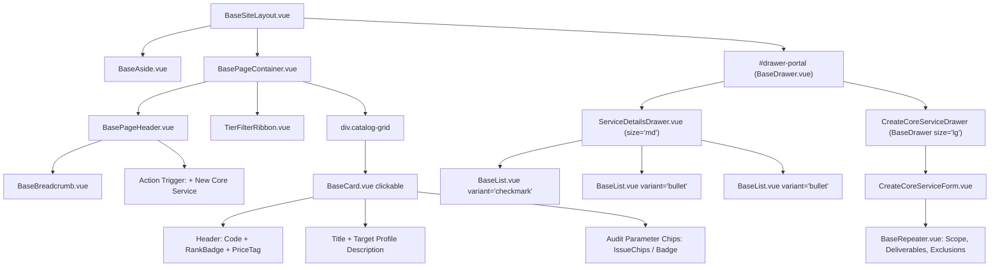

# SDD-0015: Core Service Catalog Workspace Layout and Topology Specification

## 1. Visual Topology & Spatial Architecture

The Core Service Catalog Workspace (`ServiceCatalogView.vue`) resides within the application shell (`BaseSiteLayout.vue`) mounted inside the stage canvas (`BasePageContainer.vue`). It delivers high-density catalog exploration, 4-tier commercial categorization for one-time consulting and digital transformation services (excluding recurring add-on care plans, which are isolated under `/addons`), and administrative ingestion:
1. **Header Orientation Strip:** Slotted `BasePageHeader.vue` with breadcrumbs (`Home / Catalogs / Service Catalog`), active core catalog count badge, and a primary action trigger ("+ New Core Service").
2. **Catalog Tier Sectional Ribbon:** Tier navigation anchor pills (All, Rank 1A Door-Opener, Rank 1B Specialized, Rank 3 Operational Efficiency, Rank 4 Digital Transformation) with quick-scroll and filter markers.
3. **Responsive Catalog Grid Canvas:** 3-column desktop / 2-column tablet / 1-column mobile grid of interactive cards (`BaseCard.vue` with `clickable: true`) presenting service code, name, commercial rank badge, pricing tag ($150, $350, $300, $250 flat/hybrid fees), target profile, and active audit parameter chips.
4. **Contextual Deep Inspection Drawer (`BaseDrawer.vue`):** Right-edge slideout overlay (`size="md"`, 680px) mounting `ServiceDetailsModal.vue` / `ServiceDetailsDrawer.vue` content: deliverables checklist (`BaseList.vue`), scope, exclusions, and active audit parameters.
5. **Decoupled Creation Workspace Drawer (`BaseDrawer.vue`):** Right-edge deep slideout overlay (`size="lg"`, 960px) wrapping `CreateCoreServiceForm.vue` powered by `BaseRepeater.vue` dynamic array inputs and canonical tier price calculation, providing ample horizontal canvas for 2-column input layouts and repeater rows.

```
+===================================================================================================================+
|                                           VIEWPORT (100vw x 100vh)                                                |
+=============================================+=====================================================================+
|  LEFT NAV RAIL (BaseAside.vue)              |  MAIN STAGE VIEWPORT (BasePageContainer.vue)                        |
|  [width: 240px (expanded) / 64px (rail)]    |  [flex: 1, height: 100%, overflow-y: auto, max-width: 1440px]       |
|                                             |                                                                     |
|  * 3-TIER NAVIGATION:                       |  * PAGE ORIENTATION (BasePageHeader.vue):                           |
|    - Leads (/leads)                         |    - Breadcrumbs: Home / Catalogs / Service Catalog                 |
|    - Pursued (/pursued)                     |    - Title: "Core Service Catalog"                                  |
|    - Accounts (/clients)                    |    - Subtitle: "Consulting Offerings, Fixed Scopes & Ingestion"     |
|    - Service Catalog (/services) [ACTIVE]   |    - Badges: [6 Offerings Active]                                   |
|    - Add-ons & Subs (/addons) [DECOUPLED]   |    - Actions: [ + New Core Service ]                                |
|                                             |                                                                     |
|                                             |  * TIER FILTER RIBBON (Pill Bar):                                   |
|                                             |    [ All (6) ] [ Rank 1A ] [ Rank 1B ] [ Rank 3 ] [ Rank 4 ]        |
|                                             |                                                                     |
|                                             |  * CATALOG GRID CANVAS:                                             |
|                                             |    +--------------------+ +--------------------+ +----------------+ |
|                                             |    | BaseCard (Clickable| | BaseCard (Clickable| | BaseCard ...     | |
|                                             |    | [Rank 1A]  [$150]  | | [Rank 1B]  [$350]  | | [Rank 3]  [$300] | |
|                                             |    | Core Audit Bundle  | | Deep Performance   | | Ops Efficiency   | |
|                                             |    | Target: SMB Retail | | Target: E-commerce | | Target: Multi-loc| |
|                                             |    | [Chips: ssl, perf] | | [Chips: pagespeed] | | [Chips: audit]   | |
|                                             |    +--------------------+ +--------------------+ +----------------+ |
|                                             |    (Grid: 3 cols >= 1280px, 2 cols 768-1279px, 1 col < 768px)       |
+=============================================+=====================================================================+
|  OVERLAY MOUNTING ROOTS (Teleport targets rendered directly under <body>)                                          |
|  - <div id="drawer-portal" />: BaseDrawer.vue                                                                      |
|    * Deep Service Inspection Dossier (size="md", 680px)                                                            |
|    * Register Core Service Workspace (size="lg", 960px) -> CreateCoreServiceForm.vue                               |
+===================================================================================================================+
```

---

## 2. Component Hierarchy Tree



---

## 3. Responsive Breakpoints & Layout Adapters

* **Desktop ($\ge$ 1280px):**
  - Grid: `repeat(3, minmax(0, 1fr))`, gap `1.5rem` (`var(--spacing-6)`).
  - Aside rail: 240px expanded (toggleable to 64px).
  - Inspection Drawer: `size="md"` (680px slideout).
* **Tablet (768px - 1279px):**
  - Grid: `repeat(2, minmax(0, 1fr))`, gap `1rem` (`var(--spacing-4)`).
  - Aside rail: 64px collapsed default with popover tooltips.
  - Inspection Drawer: `size="md"` (takes up to 85% viewport width).
* **Mobile (< 768px):**
  - Grid: `1fr` single-column stacked cards.
  - Aside rail: Hidden off-canvas drawer (`isMobileOpen`).
  - Inspection Drawer: `size="full"` (100% viewport width).
  - Creation Modal: Full viewport sheet overlay with sticky footer action bar.

---

## 4. Design Token Invariants

* **Surfaces & Cards:** `var(--bg-surface)` with `var(--border-color)`, hover elevation `box-shadow: var(--shadow-md)`.
* **Core Ranks & Commercial Badging:**
  - Rank 1A (Door-Opener, $150): `var(--color-primary-subtle)` / `var(--color-primary)`.
  - Rank 1B (Specialized, $350): `var(--color-info-subtle)` / `var(--color-info)`.
  - Rank 3 (Operational Efficiency, $300): `var(--color-warning-subtle)` / `var(--color-warning)`.
  - Rank 4 (Digital Transformation, $250): `var(--color-purple-subtle)` / `var(--color-purple)`.
* **Dynamic Repeater Fields:** `BaseRepeater.vue` with row border `var(--border-subtle)` and transition `0.15s ease-in-out`.
