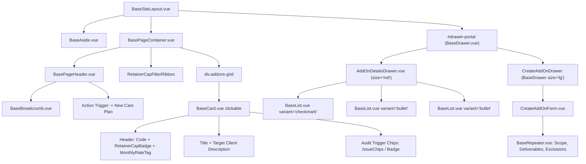

# SDD-0016: Add-ons and Recurring Subscriptions Workspace Layout and Topology Specification

## 1. Visual Topology & Spatial Architecture

The Add-ons and Subscriptions Workspace (`AddOnsView.vue`) resides within the application shell (`BaseSiteLayout.vue`) mounted inside the stage canvas (`BasePageContainer.vue`) under route `/addons`. It delivers high-density catalog exploration and administrative management for recurring digital care plans, monthly maintenance retainers, and specialized recurring service attachments, decoupled from one-off core consulting packages:
1. **Header Orientation Strip:** Slotted `BasePageHeader.vue` with breadcrumbs (`Home / Catalogs / Add-ons & Subs`), active care plans count badge, and a primary action trigger (`+ New Care Plan`).
2. **Retainer Cap Filter Ribbon:** Quick-filter pill bar filtering by allocated support time cap:
   - `All Care Plans`
   - `Automated (0m cap)` — Background probes, backups, and SSL management.
   - `Essential (30m cap)` — Small business digital continuity.
   - `Professional (60m cap)` — Priority maintenance and incident triage.
   - `Priority (90m+ cap)` — High-touch operational support.
3. **Responsive Add-on Grid Canvas:** 3-column desktop / 2-column tablet / 1-column mobile grid of interactive cards (`BaseCard.vue` with `clickable: true`) presenting plan code, monthly fee tag (e.g. `$99 / mo`, `$199 / mo`), support cap badge (`30m Support Cap`), target client profile, and active audit triggers.
4. **Contextual Add-on Inspection Drawer (`BaseDrawer.vue`):** Right-edge slideout overlay (`size="md"`, 680px) mounting deep subscription specifications: SLA commitments, recurring scope checklist (`BaseList.vue` with `variant="bullet"`), monthly client deliverables (`BaseList.vue` with `variant="checkmark"`), out-of-scope exclusions, and telemetry triggers.
5. **Decoupled Creation Workspace Drawer (`BaseDrawer.vue`):** Right-edge deep slideout overlay (`size="lg"`, 960px) wrapping `CreateAddOnForm.vue` powered by `BaseRepeater.vue` dynamic array inputs, rate presets, and support cap selections.

```
+===================================================================================================================+
|                                           VIEWPORT (100vw x 100vh)                                                |
+=============================================+=====================================================================+
|  LEFT NAV RAIL (BaseAside.vue)              |  MAIN STAGE VIEWPORT (BasePageContainer.vue)                        |
|  [width: 240px (expanded) / 64px (rail)]    |  [flex: 1, height: 100%, overflow-y: auto, max-width: 1440px]       |
|                                             |                                                                     |
|  * 3-TIER NAVIGATION:                       |  * PAGE ORIENTATION (BasePageHeader.vue):                           |
|    - Leads (/leads)                         |    - Breadcrumbs: Home / Catalogs / Add-ons & Subs                  |
|    - Pursued (/pursued)                     |    - Title: "Add-ons & Recurring Subscriptions"                     |
|    - Accounts (/clients)                    |    - Subtitle: "Monthly Digital Care Plans, Retainer Caps & SLAs"   |
|    - Service Catalog (/services)            |    - Badges: [3 Active Plans]                                       |
|    - Add-ons & Subs (/addons) [ACTIVE]      |    - Actions: [ + New Care Plan ]                                   |
|                                             |                                                                     |
|                                             |  * RETAINER CAP FILTER RIBBON (Pill Bar):                           |
|                                             |    [ All (3) ] [ Automated (0m) ] [ 30m Cap ] [ 60m Cap ] [ 90m+ ]  |
|                                             |                                                                     |
|                                             |  * SUBSCRIPTION GRID CANVAS:                                        |
|                                             |    +--------------------+ +--------------------+ +----------------+ |
|                                             |    | BaseCard (Clickable| | BaseCard (Clickable| | BaseCard ...     | |
|                                             |    | [30m Cap] [$99/mo] | | [60m Cap][$199/mo] | | [90m]  [$299/mo] | |
|                                             |    | Essential Care     | | Pro Care Plan      | | Enterprise Care  | |
|                                             |    | Target: Local SMB  | | Target: E-commerce | | Target: Priority | |
|                                             |    | [Chips: ssl, probe]| | [Chips: audit, sla]| | [Chips: 24/7]   | |
|                                             |    +--------------------+ +--------------------+ +----------------+ |
|                                             |    (Grid: 3 cols >= 1280px, 2 cols 768-1279px, 1 col < 768px)       |
+=============================================+=====================================================================+
|  OVERLAY MOUNTING ROOTS (Teleport targets rendered directly under <body>)                                          |
|  - <div id="drawer-portal" />: BaseDrawer.vue                                                                      |
|    * Deep Plan Inspection Dossier (size="md", 680px) -> AddOnDetailsDrawer.vue                                     |
|    * Register Care Plan Workspace (size="lg", 960px) -> CreateAddOnForm.vue                                        |
+===================================================================================================================+
```

---

## 2. Component Hierarchy Tree



---

## 3. Responsive Breakpoints & Layout Adapters

* **Desktop ($\ge$ 1280px):**
  - Grid: `repeat(3, minmax(0, 1fr))`, gap `1.5rem` (`var(--spacing-6)`).
  - Aside rail: 240px expanded (toggleable to 64px).
  - Inspection Drawer: `size="md"` (680px slideout).
  - Creation Drawer: `size="lg"` (960px slideout).
* **Tablet (768px - 1279px):**
  - Grid: `repeat(2, minmax(0, 1fr))`, gap `1rem` (`var(--spacing-4)`).
  - Aside rail: 64px collapsed default with popover tooltips.
  - Inspection Drawer: `size="md"` (takes up to 85% viewport width).
  - Creation Drawer: `size="lg"` (takes up to 90% viewport width).
* **Mobile (< 768px):**
  - Grid: `1fr` single-column stacked cards.
  - Aside rail: Hidden off-canvas drawer (`isMobileOpen`).
  - Inspection Drawer: `size="full"` (100% viewport width).
  - Creation Drawer: `size="full"` (100% viewport width).

---

## 4. Design Token Invariants

* **Surfaces & Cards:** `var(--bg-surface)` with `var(--border-color)`, hover elevation `box-shadow: var(--shadow-md)`.
* **Retainer & Recurring Tokens:**
  - Recurring Plan Tag: `var(--color-emerald-subtle)` / `var(--color-emerald)`.
  - Cap Badges:
    - 0m Cap (Automated): `var(--color-neutral-subtle)` / `var(--text-secondary)`.
    - 30m Cap (Essential): `var(--color-info-subtle)` / `var(--color-info)`.
    - 60m Cap (Professional): `var(--color-primary-subtle)` / `var(--color-primary)`.
    - 90m+ Cap (Priority/Enterprise): `var(--color-purple-subtle)` / `var(--color-purple)`.
* **Dynamic Repeater Fields:** `BaseRepeater.vue` with row border `var(--border-subtle)` and transition `0.15s ease-in-out`.
