# SDD-0017: Lead Operations and Triage Workspace Layout and Topology Specification

## 1. Visual Topology & Spatial Architecture

The Lead Operations and Triage Workspace (`LeadsView.vue`) resides within the application shell (`BaseSiteLayout.vue`) mounted inside the stage canvas (`BasePageContainer.vue`) under route `/leads`. It serves as the primary stage 1 qualification intake engine for discovering local SMB prospects, reviewing automated technical audit findings, qualifying high-value leads into the Pursued Pipeline (`/pursued`), or disqualifying unviable targets:
1. **Header Orientation Strip:** Slotted `BasePageHeader.vue` with breadcrumbs (`Home / Leads`), live discovery pool count badge, and a primary action trigger group (`+ Manual Lead`).
2. **Executive KPI & Triage Metrics Ribbon:** 4-column metric ribbon powered by `BaseMetricCard.vue` presenting:
   - Total Discovered Pool Leads.
   - High Opportunity Leads ($\ge$ 70 score, `danger` indicator).
   - Moderate Risk Leads (40–69 score, `warning` indicator).
   - Average Opportunity Score across pool.
3. **Unified Discovery & Filter Controls Canvas:** High-density control deck featuring:
   - `DiscoveryBar.vue`: Location search input (`location`), batch limit counter (`limit`), and primary "Discover & Audit Leads" execution button with tooltip context and "Clear Findings" secondary action.
   - `ServiceFilterDropdown.vue`: Multi-select dropdown filtering leads matching specific service audit criteria.
   - Opportunity Score slider / minimum threshold filter.
4. **Primary Stage Data Table (`BaseTable.vue`):** Standardized, sortable, responsive data table with custom column slot renders:
   - `business_name`: Business name with external link to website and contact phone.
   - `opportunity_score`: `ScoreBadge.vue` with semantic variant mapping (70+ `danger`, 40-69 `warning`, <40 `success`, null `UNAUDITED`).
   - `audit_findings`: `IssueChips.vue` showing SSL posture, PDF menu alerts, mobile viewport presence, CMS, and POS tags.
   - `actions`: Compact button cluster with primary "Qualify" (transitions lead to Pursued Pipeline) and secondary "Disqualify" (opens disqualification dialog).
5. **Contextual Overlay Portals:**
   - **Deep Lead Audit Dossier Drawer (`BaseDrawer.vue size="lg"`, 960px):** Slideout mounted via `#drawer-portal` upon row click displaying in-depth technical audit telemetry, deficit breakdown, and contact playbook.
   - **Manual Lead Ingestion Drawer (`BaseDrawer.vue size="lg"`, 960px):** Slideout mounted via `#drawer-portal` hosting `ManualLeadForm.vue`.
   - **Disqualification Modal (`BaseModal.vue`):** Centered dialog mounted via `#modal-portal` wrapping `DisqualifyLeadForm.vue` with permanent suppression checkbox.

```
+===================================================================================================================+
|                                           VIEWPORT (100vw x 100vh)                                                |
+=============================================+=====================================================================+
|  LEFT NAV RAIL (BaseAside.vue)              |  MAIN STAGE VIEWPORT (BasePageContainer.vue)                        |
|  [width: 240px (expanded) / 64px (rail)]    |  [flex: 1, height: 100%, overflow-y: auto, max-width: 1440px]       |
|                                             |                                                                     |
|  * 3-TIER NAVIGATION:                       |  * PAGE ORIENTATION (BasePageHeader.vue):                           |
|    - Leads (/leads) [ACTIVE]                |    - Breadcrumbs: Home / Leads                                      |
|    - Pursued (/pursued)                     |    - Title: "Lead Operations & Triage"                              |
|    - Accounts (/clients)                    |    - Subtitle: "Discover, Audit, and Qualify Business Opportunities"|
|    - Service Catalog (/services)            |    - Badges: [24 Pool Leads]                                        |
|    - Add-ons & Subs (/addons)               |    - Actions: [ + Manual Lead ]                                     |
|                                             |                                                                     |
|                                             |  * KPI METRIC RIBBON (4 Columns):                                   |
|                                             |    +----------------+ +----------------+ +------------------------+ |
|                                             |    | BaseMetricCard | | BaseMetricCard | | BaseMetricCard ...       | |
|                                             |    | Total Leads: 24| | High Risk: 8   | | Moderate: 12 | Avg: 68.4 | |
|                                             |    +----------------+ +----------------+ +------------------------+ |
|                                             |                                                                     |
|                                             |  * DISCOVERY & SERVICE FILTER DECK:                                 |
|                                             |    [ Location Input ] [ Limit ] [ Discover & Audit ] [ Clear ]     |
|                                             |    [ Service Filter Dropdown (All Services) ] [ Min Score Slider ]  |
|                                             |                                                                     |
|                                             |  * LEAD TRIAGE DATA TABLE (BaseTable.vue):                          |
|                                             |    +--------------------------------------------------------------+ |
|                                             |    | Business & Contact | Opportunity | Technical Findings | Action | |
|                                             |    |--------------------+-------------+--------------------+--------| |
|                                             |    | Kalamazoo Bakery   | [ 85 / 100 ]| [No SSL][PDF Menu] |[Qualify| |
|                                             |    | Main St Pizza      | [ 42 / 100 ]| [SSL OK][No Mobile]| [Disq] | |
|                                             |    +--------------------------------------------------------------+ |
+=============================================+=====================================================================+
|  OVERLAY MOUNTING ROOTS (Teleport targets rendered directly under <body>)                                          |
|  - <div id="drawer-portal" />: BaseDrawer.vue (size="lg", 960px) -> OpportunityDossierDrawer.vue / ManualLeadForm   |
|  - <div id="modal-portal" />: BaseModal.vue -> DisqualifyLeadForm.vue                                              |
+===================================================================================================================+
```

---

## 2. Component Hierarchy Tree

```mermaid
flowchart TD
    Shell[BaseSiteLayout.vue] --> Aside[BaseAside.vue]
    Shell --> Stage[BasePageContainer.vue]
    Stage --> Header[BasePageHeader.vue]
    Header --> Breadcrumbs[BaseBreadcrumb.vue]
    Header --> HeaderActions[Action Trigger: + Manual Lead]
    Stage --> MetricRibbon[div.metrics-ribbon]
    MetricRibbon --> Metric1[BaseMetricCard: Total Pool Leads]
    MetricRibbon --> Metric2[BaseMetricCard: High Opportunity Score >= 70]
    MetricRibbon --> Metric3[BaseMetricCard: Moderate Risk 40-69]
    MetricRibbon --> Metric4[BaseMetricCard: Average Pool Score]
    Stage --> ControlDeck[div.triage-controls]
    ControlDeck --> DiscoveryBar[DiscoveryBar.vue]
    ControlDeck --> ServiceFilter[ServiceFilterDropdown.vue]
    Stage --> TableContainer[BaseTable.vue]
    TableContainer --> Col1[Cell: Business Name + Website + Phone]
    TableContainer --> Col2[Cell: ScoreBadge.vue]
    TableContainer --> Col3[Cell: IssueChips.vue]
    TableContainer --> Col4[Cell: Action Group - Qualify Button / Disqualify Button]
    Shell --> DrawerPortal["#drawer-portal (BaseDrawer.vue size='lg')"]
    DrawerPortal --> LeadDossier[OpportunityDossierDrawer.vue]
    DrawerPortal --> ManualDrawer[ManualLeadDrawer]
    ManualDrawer --> ManualForm[ManualLeadForm.vue]
    Shell --> ModalPortal["#modal-portal (BaseModal.vue)"]
    ModalPortal --> DisqualifyModal[DisqualifyModal]
    DisqualifyModal --> DisqualifyForm[DisqualifyLeadForm.vue]
```



---

## 3. Responsive Breakpoints & Table Column Adapters

* **Desktop ($\ge$ 1280px):**
  - Metric Ribbon: 4-column grid (`repeat(4, 1fr)`).
  - Triage Table: Full 4-column display (`Business & Contact` 35%, `Opportunity Score` 15%, `Technical Findings` 30%, `Actions` 20%).
  - Slideout Dossier & Manual Ingress: `size="lg"` (960px width).
* **Tablet (768px - 1279px):**
  - Metric Ribbon: 2-column grid (`repeat(2, 1fr)`).
  - Triage Table: Responsive scroll container with sticky Actions column.
  - Slideout Drawers: Takes up to 85% of stage width.
* **Mobile (< 768px):**
  - Metric Ribbon: 1-column stacked cards.
  - Triage Table: Horizontal scrolling card-like table rows.
  - Drawers: `size="full"` (100% viewport width).

---

## 4. Design Token Invariants

* **Surfaces & Cards:** `var(--bg-surface)` with `var(--border-color)`, hover elevation `box-shadow: var(--shadow-sm)`.
* **Score Badge Tokens:**
  - Danger ($\ge 70$): `var(--badge-danger-bg)` / `var(--badge-danger-text)`.
  - Warning (40–69): `var(--badge-warning-bg)` / `var(--badge-warning-text)`.
  - Success ($< 40$): `var(--badge-success-bg)` / `var(--badge-success-text)`.
  - Unaudited: `var(--badge-neutral-bg)` / `var(--badge-neutral-text)`.
* **Button Semantics:**
  - Qualify: `variant="primary"` (triggers pipeline transition).
  - Disqualify: `variant="secondary"` / `variant="danger-outline"`.
  - Discover & Audit: `variant="primary"` with contextual hover tooltip.
