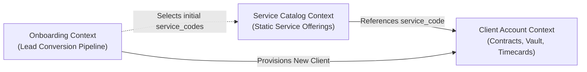
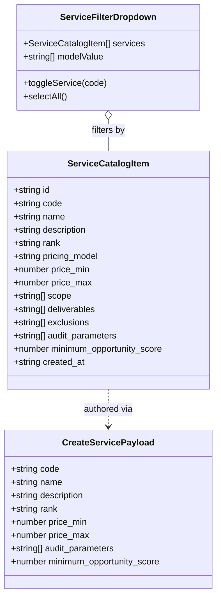
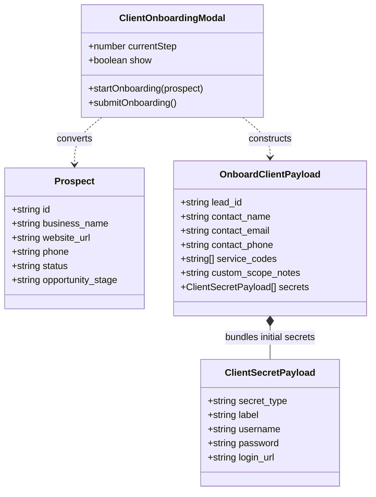
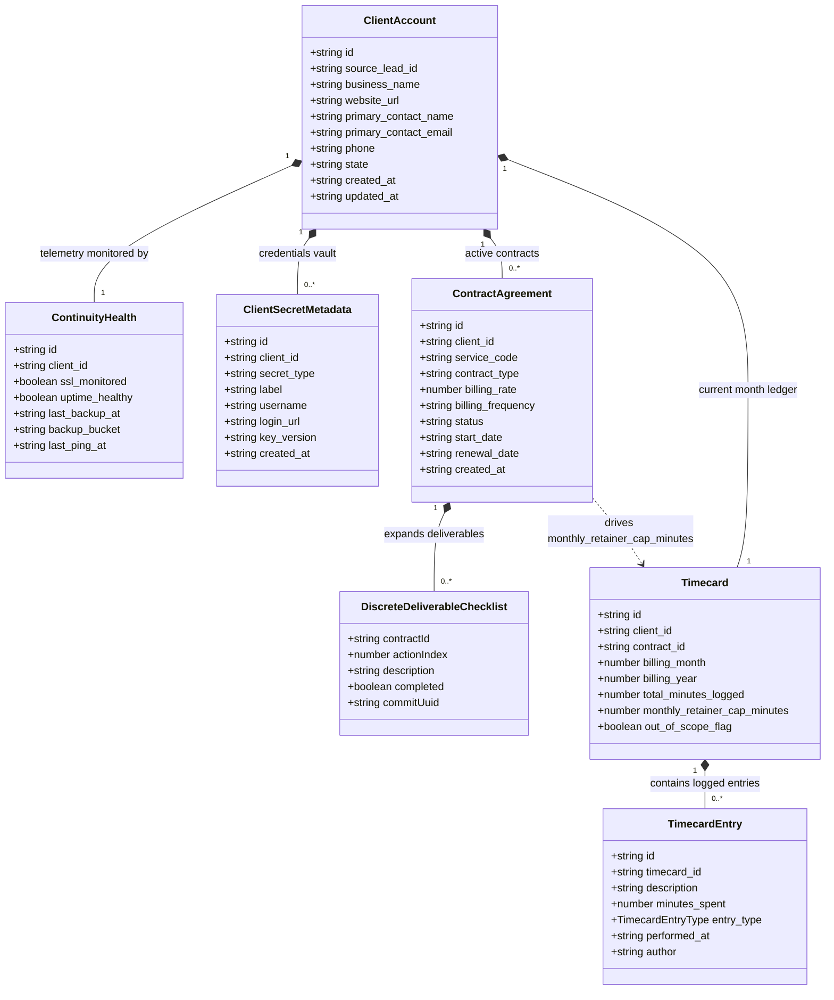

# As-Built System Architecture & Domain Relationships

This document visualizes the exact as-built composition, data schemas, and structural relationships across the 5 core systems in `smb-ops-frontend`. Rather than a single entangled view, systems are partitioned into their **3 distinct, decoupled Bounded Contexts**.

---

## 1. High-Level Bounded Context Map

The three systems are loosely coupled via string identifiers (`service_code` and `lead_id`):

---

## 2. Diagram 1: Service Catalog System (Isolated Aggregate)

The Service Catalog is completely self-contained. It defines standard operational offerings, pricing boundaries, and technical audit parameters.

---

## 3. Diagram 2: Onboarding Pipeline & Conversion Flow

The Onboarding system is a transient pipeline that captures operator input and provisions a new client account from an existing prospect.

---

## 4. Diagram 3: Client Account, Contracts, Vault & Timecards (Core Cluster)

The Client Account is the primary operational Aggregate Root. It directly owns continuity telemetry, secret credentials, active service contracts, and monthly work timecards.

---

## 5. Architectural Invariants & Coupling Rules

1. **Service Catalog Decoupling:**
   * The Service Catalog has **zero foreign keys** to clients, contracts, or leads.
   * `ContractAgreement` stores a snapshot string `service_code` (e.g. `"CARE_PLAN_30"`), ensuring contract terms remain immutable even if catalog pricing changes later.
2. **Onboarding Pipeline Decoupling:**
   * The onboarding modal is purely a presentation pipeline. Once `POST /clients` succeeds, the modal is destroyed and the resulting `ClientAccount` is self-governing.
3. **Timecard & Retainer Cohesion:**
   * A `ClientAccount` has one active `Timecard` per billing cycle.
   * Only contracts with `contract_type === 'retainer'` increase `Timecard.monthly_retainer_cap_minutes`.
   * Only `TimecardEntry` items with `entry_type === 'retainer_maintenance'` consume the monthly allowance; `billable_extra` and `internal_non_billable` entries are recorded in the ledger without deducting from the cap.
