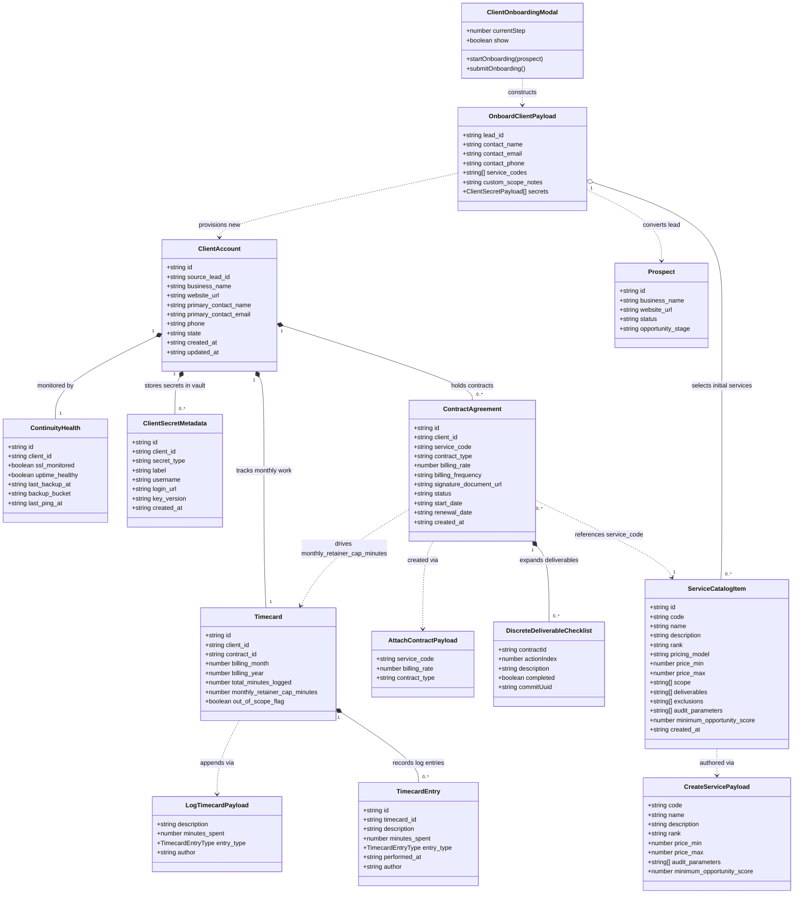

# As-Built System Architecture & Domain Relationships

This document visualizes the exact as-built composition, data schemas, and structural relationships across the 5 core systems in `smb-ops-frontend`:
1. **Client Account System**
2. **Onboarding Pipeline**
3. **Service Catalog**
4. **Add-ons & Recurring Contracts**
5. **Timecards & Retainer Maintenance**

---

## 1. Unified As-Built System Class Diagram

---

## 2. Detailed Subsystem Breakdowns

### 1. Client Account Subsystem
* **Core Entity:** `ClientAccount` represents an active business client converted from a `Prospect`.
* **Telemetry & Security:**
  - `ContinuityHealth`: Real-time probe telemetry (SSL, HTTP uptime, backup bucket, last ping).
  - `ClientSecretMetadata`: Vault-stored credentials encrypted at rest with masked view and 15s reveal countdown.

### 2. Onboarding Pipeline Subsystem
* **Flow:** `Prospect` (Status: `PURSUED`, Stage: `converted`) $\rightarrow$ `ClientOnboardingModal` (4-step stepper) $\rightarrow$ `OnboardClientPayload` $\rightarrow$ `POST /clients`.
* **Provisioning:** Creates the `ClientAccount`, initializes `ContinuityHealth`, provisions selected initial service contracts, and injects first vault credentials.

### 3. Service Catalog Subsystem
* **Entity:** `ServiceCatalogItem` defines standard operational offerings with codes (`WEB_HOSTING`, `CARE_PLAN_30`, `LOCAL_SEO`).
* **Governance Invariants:**
  - Contains pricing bounds (`price_min`, `price_max`).
  - Contains `audit_parameters` and `minimum_opportunity_score` used by `ServiceFilterDropdown` to qualify prospects in triage.
  - Contains `deliverables[]` and `scope[]` lists.

### 4. Add-ons & Recurring Contracts Subsystem
* **Entity:** `ContractAgreement` links a `ClientAccount` to a `ServiceCatalogItem.code`.
* **Types:**
  - `retainer`: Recurring monthly plans (`CARE_PLAN_30`, `CARE_PLAN_60`, `CARE_PLAN_90`) that inject monthly allowance minutes into `Timecard.monthly_retainer_cap_minutes`.
  - `fixed_fee`: One-time setup or project deliverables.
* **Deliverables Accordion:** Each contract expands in the dossier to render interactive deliverable checkboxes with Git commit UUID tags (`localStorage` persistence).

### 5. Timecards & Retainer Subsystem
* **Entity:** `Timecard` tracks the current billing cycle's logged work for a client.
* **Entries:** `TimecardEntry` records individual work bursts tagged with `TimecardEntryType`:
  1. `retainer_maintenance`: Consumes monthly retainer cap (e.g. 30m/mo).
  2. `billable_extra`: Logged beyond or outside retainer scope (billed separately).
  3. `internal_non_billable`: Pro-bono or diagnostic triage work.
* **Gauge:** `MaintenanceGauge.vue` calculates percentage consumption ($MinutesLogged / CapMinutes$) and signals green, warning amber, or overage rose.
