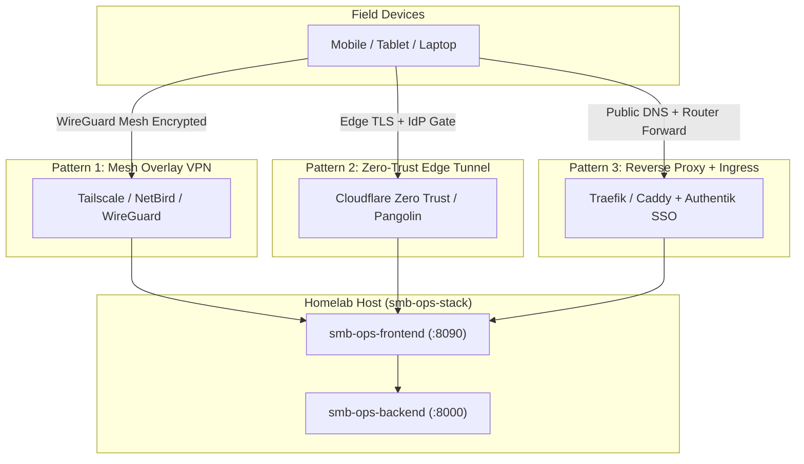

# Remote Field Access Topology & Ingress Architecture

## 1. Diagnostic
Once the SMB Ops container stack (`smb-ops-frontend` and `smb-ops-backend`) is deployed on a dedicated host within a private residential or local area network, field operators require remote access to the UI dashboard (exposed locally on port `8090`) from mobile devices, tablets, or laptops outside the local subnet. Direct router port forwarding without zero-trust controls introduces severe attack surfaces, including credential spraying, brute-force exploits, and unauthorized ingress into the internal homelab network.

## 2. Theory
Secure remote access across residential NAT/firewalls follows one of three architectural patterns:



1. **Mesh Overlay VPN (Zero-Trust Point-to-Point):** Outbound-only tunnel creating an encrypted private virtual overlay network (e.g., WireGuard, Tailscale) without opening public router ports.
2. **Reverse Tunnel / Edge Proxy:** Outbound-only TLS connection brokered through an edge provider (e.g., Cloudflare Tunnels, Pangolin, Inlets) with identity/SSO gating.
3. **Public Reverse Proxy Gateway:** Dynamic DNS or static IP with router ports 80/443 forwarded to an internal reverse proxy (Caddy/Traefik) guarded by multi-factor authentication / SSO middleware (Authentik/Authelia).

## 3. Analysis

### Option A: Tailscale (Mesh Overlay VPN) — *Recommended for Single-Operator Field Access*
* **Mechanism:** The homelab host runs the Tailscale daemon (`tailscaled`). Field devices install the Tailscale client and authenticate into the private tailnet. The dashboard is accessed via MagicDNS (e.g., `http://homelab-node:8090` or `https://homelab-node.tailnet.ts.net`).
* **Pros:**
  * Outbound-only connection: zero open router firewall ports required.
  * End-to-end WireGuard cryptographic isolation.
  * Automatic HTTPS certificates provisioned via Tailscale MagicDNS.
  * Native iOS, Android, macOS, and Linux clients with biometric re-auth.
* **Cons:**
  * Requires Tailscale client software installed and running on every field device.
  * Shared/guest access requires provisioning tailnet shares or Tailscale Funnel.

### Option B: Cloudflare Tunnel (`cloudflared`) — *Recommended for Seamless Browser Access*
* **Mechanism:** Homelab host runs a `cloudflared` container or systemd service establishing outbound WebSocket/HTTP2 tunnels to Cloudflare edge nodes. Public hostname (e.g., `ops.yourdomain.com`) routes to `http://localhost:8090`.
* **Pros:**
  * No client software needed: access from any mobile or desktop browser via HTTPS.
  * Zero open inbound ports on residential router.
  * Protection via Cloudflare Access / Zero Trust application rules (Google/GitHub OIDC, PIN codes).
* **Cons:**
  * Requires owning a custom domain delegated to Cloudflare DNS.
  * Traffic decrypts at Cloudflare edge proxies before traversing tunnel.

### Option C: Standalone WireGuard / NetBird Gateway
* **Mechanism:** Dedicated WireGuard endpoint configured on router (OPNsense/UniFi) or homelab host with dynamic DNS.
* **Pros:**
  * 100% self-sovereign with no third-party coordination server.
  * High throughput and lightweight battery footprint on mobile devices.
* **Cons:**
  * Requires port forwarding UDP (default 51820) on WAN router.
  * Requires manual public key exchange and configuration profile distribution.

### Option D: Reverse Proxy + Authentik/Authelia Ingress
* **Mechanism:** Router forwards ports 80/443 to internal Caddy/Traefik container with forward-auth middleware before reaching the dashboard.
* **Pros:**
  * Standard public web interface accessible from anywhere without VPN.
* **Cons:**
  * Exposes web server attack surface directly to internet scanners.
  * Substantial operational overhead to maintain certificates, DNS, fail2ban, and SSO middleware.

## 4. Remediation & Implementation Guide

### Recommended Immediate Setup: Tailscale

1. **Host Configuration:**
   Install and authenticate Tailscale on the host running `smb-ops-stack`:
   ```bash
   curl -fsSL https://tailscale.com/install.sh | sh
   sudo tailscale up --operator=$USER
   ```
2. **Accessing SMB Ops Dashboard:**
   * Retrieve host Tailscale IP: `tailscale ip -4`
   * From connected field device, navigate to: `http://<tailscale-ip>:8090/`
3. **Optional MagicDNS with Automatic HTTPS:**
   ```bash
   sudo tailscale serve --bg 8090
   ```
   Enables automated Let's Encrypt TLS access at `https://<hostname>.<tailnet>.ts.net`.
