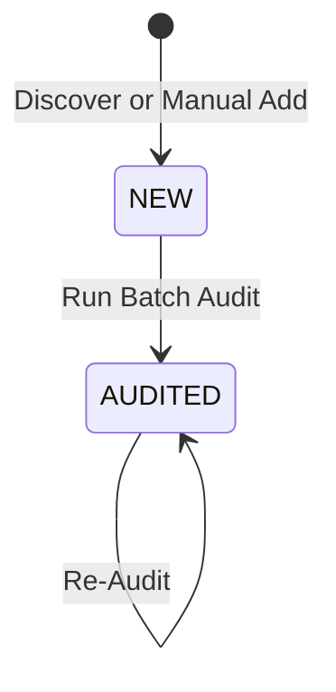

# 0001: Lead Lifecycle State Transitions (As-Is)

## 1. Entity Overview

* **Entity Name:** `Lead` / `Prospect`
* **Primary Identifier:** `prospect.id` (`UUID`)
* **Owning Domain / Slice:** `entities/lead`
* **Backend Source:** `smb-ops-backend/src/smb_ops_api/core/models/prospect.py` & `audit.py`

## 2. State Definitions

* `NEW`: Discovered lead or manually entered business prospect; audit not yet executed (`audit == null`).
* `AUDITED`: Technical infrastructure inspected; opportunity score (0–100) and issue flags computed.

## 3. Transition Matrix (As-Is)

| Source State | Trigger Event | Guard / Precondition | Target State | Side Effect / Action |
| :--- | :--- | :--- | :--- | :--- |
| `[*] (None)` | `DISCOVER_PROSPECTS` | Valid location query | `NEW` | Inserts batch of unvetted leads via API |
| `[*] (None)` | `MANUAL_CREATE_LEAD` | Valid name & phone/url | `NEW` | Inserts single lead record |
| `NEW` | `RUN_BATCH_AUDIT` | Lead is un-audited | `AUDITED` | Runs HTTP checks, generates `AuditRecord` |
| `AUDITED` | `RE_AUDIT` | None | `AUDITED` | Overwrites score & issue flags |

## 4. State Diagram

## 5. UI Guard Rules (As-Is)

* When status is `NEW`: Badge displays `NEW` in neutral grey; score displays `N/A`.
* When status is `AUDITED`: Badge displays `AUDITED` in blue/primary; score badge rendered with color thresholds (green $\ge 70$, amber $40-69$, red $< 40$).
