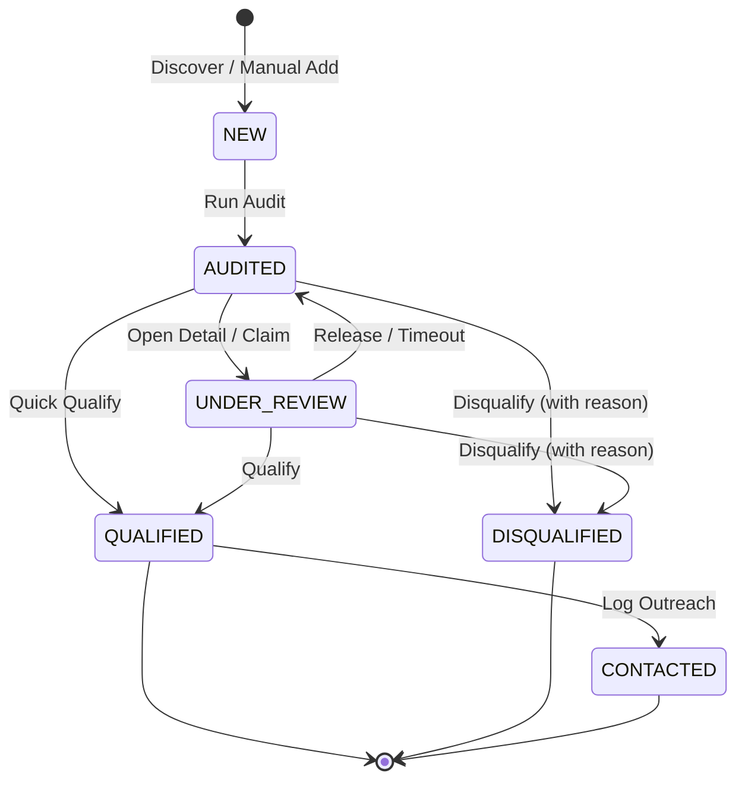

# 0002: Lead Disposition & Triage Lifecycle (Target Specification)

## 1. Entity Overview

* **Entity Name:** `Lead` / `Prospect`
* **Primary Identifier:** `prospect.id` (`UUID`)
* **Owning Domain / Slice:** `entities/lead`
* **Supersedes / Extends:** `0001_lead_lifecycle_state_transitions.md`

## 2. State Definitions

* `NEW`: Discovered lead or manually entered business prospect; technical audit pending.
* `AUDITED`: Technical infrastructure inspected; opportunity score (0–100) and issue flags computed. Awaiting human operator disposition.
* `UNDER_REVIEW`: Locked by an operator for active evaluation to prevent concurrent triage conflicts.
* `QUALIFIED`: Lead vetted and marked eligible for sales outreach or customer onboarding.
* `DISQUALIFIED`: Terminal state; lead rejected based on criteria (e.g., closed business, franchise exclusion, invalid contact).
* `CONTACTED`: Outreach initiated; transferred out of the active triage queue.

## 3. Transition Matrix

| Source State | Trigger Event | Guard / Precondition | Target State | Side Effect / Action |
| :--- | :--- | :--- | :--- | :--- |
| `NEW` | `RUN_BATCH_AUDIT` | Un-audited lead | `AUDITED` | Runs HTTP checks, generates `AuditRecord` |
| `AUDITED` | `START_REVIEW` | Assigned to operator | `UNDER_REVIEW` | Sets lock expiration (15m lease) |
| `AUDITED` / `UNDER_REVIEW` | `QUALIFY_LEAD` | Opportunity score $\ge 40$ | `QUALIFIED` | `POST /leads/:id/qualify`, archives from queue |
| `AUDITED` / `UNDER_REVIEW` | `DISQUALIFY_LEAD` | Reason code specified | `DISQUALIFIED` | `POST /leads/:id/disqualify`, persists reason |
| `QUALIFIED` | `RECORD_CONTACT` | Contact channel logged | `CONTACTED` | Hands off to outreach pipeline |
| `UNDER_REVIEW` | `CANCEL_REVIEW` | Operator releases | `AUDITED` | Removes lock lease |

## 4. State Diagram

## 5. UI Guard Rules

* **Active Triage Queue View (`/`):**
  * Displays only leads with status `AUDITED` and `UNDER_REVIEW`.
  * Once a lead transitions to `QUALIFIED` or `DISQUALIFIED`, it is immediately removed from the active queue.
* **Row Actions:**
  * Leads in `NEW` state show only "Run Audit" button (Triage buttons disabled).
  * Leads in `AUDITED` state show active "Qualify" and "Disqualify" actions.
* **Disqualification Dialog:**
  * Must capture one mandatory reason: `Out of Business`, `No Website Needed`, `Enterprise / Non-SMB`, `Invalid Phone / Address`, `Other`.
