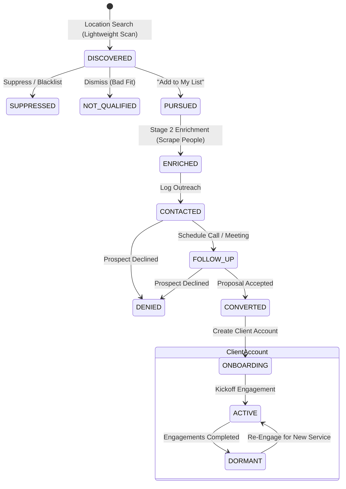

# 0003: Service Catalog, Pursued Leads, and Client Lifecycle

## 1. Domain Overview & Entity Entities

This specification governs the transformation lifecycle from raw discovered leads into active client consulting accounts, keyed to the consulting firm's **Service Catalog**.

* **Root Entities:**
  * `ServiceCatalogItem`: The practice's billable services (`code`, `name`, `audit_rules`).
  * `BusinessEntity`: The real-world SMB (`business_name`, canonical address, domain).
  * `Lead`: The pipeline candidate (`lead_id`, `business_id`, `state`, `qualified_services[]`).
  * `ClientAccount`: The contracted paying client (`client_id`, `lead_id`, `business_id`, `state`).

---

## 2. Lead & Client Lifecycle States

### Lead Lifecycle States
* `DISCOVERED`: Discovered business via location query; lightweight non-invasive digital scan performed.
* `PURSUED`: Operator explicitly selected the lead to pursue ("Add to My List"). Triggers Stage 2 contact enrichment.
* `ENRICHED`: Background scraper identified key people (owners, managers, verified emails, phone numbers).
* `CONTACTED`: Cold or warm outreach initiated by the operator.
* `FOLLOW_UP`: In active dialogue; awaiting meeting or proposal decision.
* `DENIED`: Lead explicitly declined services (retained with denial reason).
* `NOT_QUALIFIED`: Lead rejected during vetting (e.g., closed business, no technical fit).
* `SUPPRESSED`: Operator marked as ignored/excluded; blacklisted from future discovery queries.
* `CONVERTED`: Lead accepted proposal and transitioned to `ClientAccount`.

### Client Account Lifecycle States
* `ONBOARDING`: Contract signed; initial discovery audit and stakeholder kickoff in progress.
* `ACTIVE`: One or more service engagements/jobs are actively being delivered.
* `DORMANT`: Current engagements completed; account maintained for periodic re-audit.

---

## 3. Transition Matrix

| Entity | Source State | Trigger Event | Guard / Precondition | Target State | Side Effect / Action |
| :--- | :--- | :--- | :--- | :--- | :--- |
| `Lead` | `[*] (None)` | `QUERY_LOCATION` | Valid city/state/zip | `DISCOVERED` | Lightweight scan; populate discovery pool |
| `Lead` | `DISCOVERED` | `PURSUED_BY_OPERATOR` | None | `PURSUED` | Assign durable UID; enqueue Stage 2 contact scraper |
| `Lead` | `PURSUED` | `ENRICHMENT_COMPLETED` | Scraper returns contacts | `ENRICHED` | Populate key people, emails, phone numbers |
| `Lead` | `DISCOVERED` / `PURSUED` | `SUPPRESS_LEAD` | None | `SUPPRESSED` | Add domain/name to exclusion table |
| `Lead` | `ENRICHED` | `INITIATE_OUTREACH` | Channel specified (email/call) | `CONTACTED` | Record outreach timestamp |
| `Lead` | `CONTACTED` | `SCHEDULE_MEETING` | Meeting timestamp set | `FOLLOW_UP` | Set calendar reminder |
| `Lead` | `CONTACTED` / `FOLLOW_UP` | `DECLINED_OFFER` | Reason code recorded | `DENIED` | Archive lead with feedback |
| `Lead` | `FOLLOW_UP` | `ACCEPT_PROPOSAL` | Signed engagement | `CONVERTED` | Instantiate `ClientAccount` (Lineage: `lead_id`) |
| `Client` | `[*] (CONVERTED)` | `CREATE_ACCOUNT` | Valid `lead_id` | `ONBOARDING` | Initialize project workspace & meeting log |
| `Client` | `ONBOARDING` | `START_SERVICE_JOB` | Service item assigned | `ACTIVE` | Track billable service milestones |

---

## 4. State Diagram

---

## 5. Invariants & Multi-Unit Edge Cases

1. **Lead to Client 1:1 Lineage:**
   * One `Lead` converts to exactly one `ClientAccount`.
   * Invariant: `ClientAccount.source_lead_id` is unique and immutable.
2. **Multi-Unit / Franchise Restaurant Handling:**
   * When multiple physical store leads belong to the same parent restaurant group, the parent entity is promoted to `ClientAccount`, and individual stores are linked as child `Locations` under that account.
3. **Multi-Service Qualification:**
   * A lead may qualify for multiple services simultaneously (e.g., `SVC-SEO` score: 85, `SVC-WEB` score: 90). The lead displays chips for each qualified service.
