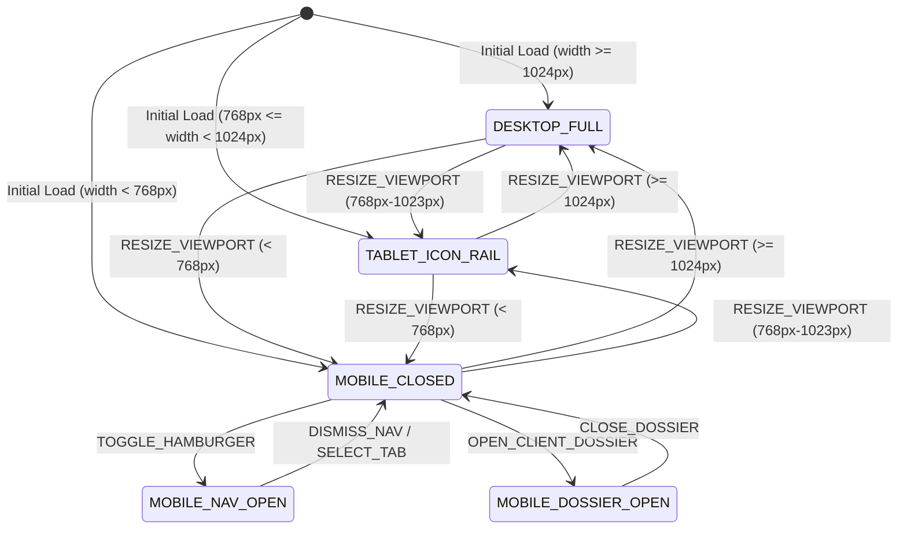

# 0004: Responsive Viewport and Navigation States

## 1. Entity Overview

* **Entity Name:** `ViewportNavigationLayout`
* **Primary Identifier:** `viewport_mode`
* **Owning Domain / Slice:** `features/navigation`, `features/client-dossier`, `pages/HomeView`
* **Frontend Scope:** Reactive breakpoint detection (`< 768px`, `768px - 1024px`, `> 1024px`) and navigation/drawer display mode.

## 2. State Definitions

* `DESKTOP_FULL`: Viewport $\ge$ 1024px. Aside rail is sticky with full 240px width displaying icons and text labels. Dossier drawer renders as standard 540px side drawer.
* `TABLET_ICON_RAIL`: Viewport between 768px and 1023px. Aside rail collapses to compact 64px width showing icons only with hover tooltips. Dossier drawer takes 480px or max 80vw.
* `MOBILE_CLOSED`: Viewport < 768px. Aside rail is hidden off-canvas. A sticky top mobile header bar renders a hamburger button and brand badge. Dossier drawer is closed.
* `MOBILE_NAV_OPEN`: Viewport < 768px. Hamburger button toggled. Aside navigation slides in as full-height 280px drawer over a backdrop overlay (`z-index: 100`).
* `MOBILE_DOSSIER_OPEN`: Viewport < 768px. Client dossier drawer opened. Drawer renders as 100% full-width slide-over with touch-friendly header dismiss button and isolated vertical scrolling.

## 3. Transition Matrix

| Source State | Trigger Event | Guard / Precondition | Target State | Side Effect / Action |
| :--- | :--- | :--- | :--- | :--- |
| `*` | `RESIZE_VIEWPORT` | `width >= 1024px` | `DESKTOP_FULL` | Closes mobile overlays; resets nav rail to 240px |
| `*` | `RESIZE_VIEWPORT` | `768px <= width < 1024px` | `TABLET_ICON_RAIL` | Closes mobile overlays; collapses rail to 64px icon mode |
| `*` | `RESIZE_VIEWPORT` | `width < 768px` | `MOBILE_CLOSED` | Hides rail off-canvas; activates hamburger trigger |
| `MOBILE_CLOSED` | `TOGGLE_HAMBURGER` | `is_mobile == true` | `MOBILE_NAV_OPEN` | Opens flyout nav; locks body scroll |
| `MOBILE_NAV_OPEN` | `DISMISS_NAV` / `SELECT_TAB` | None | `MOBILE_CLOSED` | Closes flyout nav; restores body scroll |
| `MOBILE_CLOSED` | `OPEN_CLIENT_DOSSIER` | `is_mobile == true` | `MOBILE_DOSSIER_OPEN` | Opens 100% full-width dossier drawer |
| `MOBILE_DOSSIER_OPEN`| `CLOSE_DOSSIER` | None | `MOBILE_CLOSED` | Slides out dossier drawer |

## 4. State Diagram

## 5. UI Guard Rules

* On Mobile (`width < 768px`):
  * Nav link click must trigger `selectTab` and immediately close the flyout drawer.
  * Backdrop click must trigger `dismiss`.
  * Touch swipe or ESC key triggers dismiss.
  * Dossier drawer must occupy `100vw` without horizontal scroll bleeding.
