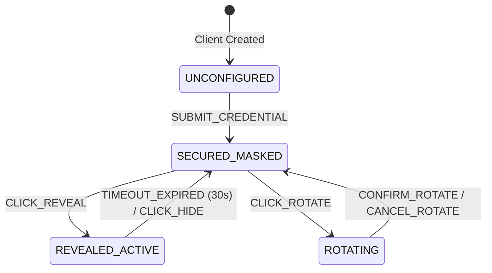

# 0005: Client Credential Vault States

## 1. Entity Overview

* **Entity Name:** `ClientCredentialEntry`
* **Primary Identifier:** `secret_id`
* **Owning Domain / Slice:** `entities/client-account`, `features/client-dossier`, `features/client-onboarding`
* **Backend Source of Truth:** `smb-ops-backend/src/smb_ops_api/core/models/client.py`

## 2. State Definitions

* `UNCONFIGURED`: No credentials stored for this service type. Form inputs are blank and editable.
* `SECURED_MASKED`: Credential ciphertext persisted in backend vault. UI renders metadata (username, URL, last updated) and masked dots (`••••••••••••`) with copy and reveal actions.
* `REVEALED_ACTIVE`: Plaintext has been explicitly fetched by the operator. Displayed with an active countdown timer (30 seconds) before automatic re-masking.
* `ROTATING`: Operator has initiated credential update; modal or inputs enter pending save state.

## 3. Transition Matrix

| Source State | Trigger Event | Guard / Precondition | Target State | Side Effect / Action |
| :--- | :--- | :--- | :--- | :--- |
| `UNCONFIGURED` | `SUBMIT_CREDENTIAL` | `username != '' && password != ''` | `SECURED_MASKED` | POST `/api/clients/:id/secrets`; encrypts in vault |
| `SECURED_MASKED` | `CLICK_REVEAL` | None | `REVEALED_ACTIVE` | POST `/api/clients/:id/secrets/:id/reveal`; starts 30s auto-hide timer |
| `REVEALED_ACTIVE` | `TIMEOUT_EXPIRED` | 30s elapsed | `SECURED_MASKED` | Purges plaintext from frontend memory; resets view to masked dots |
| `REVEALED_ACTIVE` | `CLICK_HIDE` | Manual hide trigger | `SECURED_MASKED` | Purges plaintext immediately |
| `SECURED_MASKED` | `CLICK_ROTATE` | None | `ROTATING` | Opens rotation input |
| `ROTATING` | `CONFIRM_ROTATE` | `new_password != ''` | `SECURED_MASKED` | Updates ciphertext in vault |
| `ROTATING` | `CANCEL_ROTATE` | None | `SECURED_MASKED` | Reverts to existing masked state |

## 4. State Diagram

## 5. UI Guard Rules

* Plaintext passwords must **never** be cached in localStorage or Pinia global stores.
* When copying password to clipboard, show a brief success checkmark and flush the in-memory clipboard buffer after 45 seconds if supported.
* Secret reveal triggers a confirm toast with operator audit warning.
