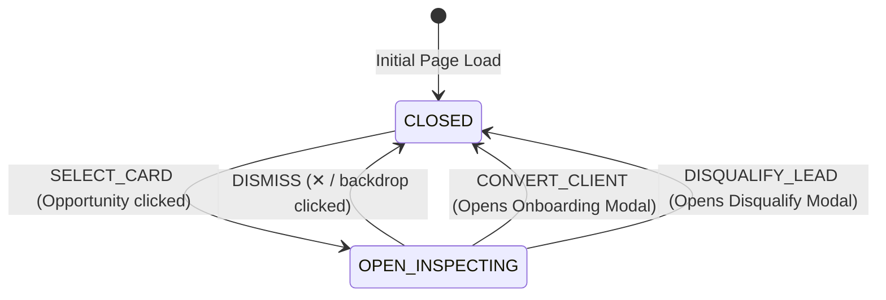

# 0006: Pursued Opportunity Drawer States

## 1. Entity Overview

* **Entity Name:** `OpportunityDossierDrawer`
* **Owning Slice:** `features/opportunity-dossier`
* **Parent View:** `src/pages/HomeView.vue` (`activeTab === 'pipeline'`)

## 2. State Definitions

* `CLOSED`: Drawer is hidden from viewport (`show = false`).
* `OPEN_INSPECTING`: Drawer is active and visible (`show = true`, `lead != null`). Displays business profile, calculated opportunity score, technical deficit factors, and matching service packages.
* `TRANSITION_TO_ONBOARD`: Drawer closes, immediately triggering `ClientOnboardingModal` for the active lead.
* `TRANSITION_TO_DISQUALIFY`: Drawer closes, immediately triggering `DisqualifyModal` for the active lead.

## 3. Transition Matrix

| Source State | Trigger Event | Guard / Precondition | Target State | Side Effect / Action |
| :--- | :--- | :--- | :--- | :--- |
| `CLOSED` | `SELECT_CARD` | `lead.prospect.status === 'PURSUED'` | `OPEN_INSPECTING` | Slide animation (right to left); backdrop rendered |
| `OPEN_INSPECTING`| `DISMISS` | Click ✕ or overlay backdrop | `CLOSED` | Slide animation (left to right); clears active lead |
| `OPEN_INSPECTING`| `CONVERT_CLIENT` | Operator clicks "Convert to Client" | `TRANSITION_TO_ONBOARD` | Drawer closes; opens `ClientOnboardingModal` |
| `OPEN_INSPECTING`| `DISQUALIFY_LEAD` | Operator clicks "Disqualify Lead" | `TRANSITION_TO_DISQUALIFY` | Drawer closes; opens `DisqualifyModal` |

## 4. State Diagram

