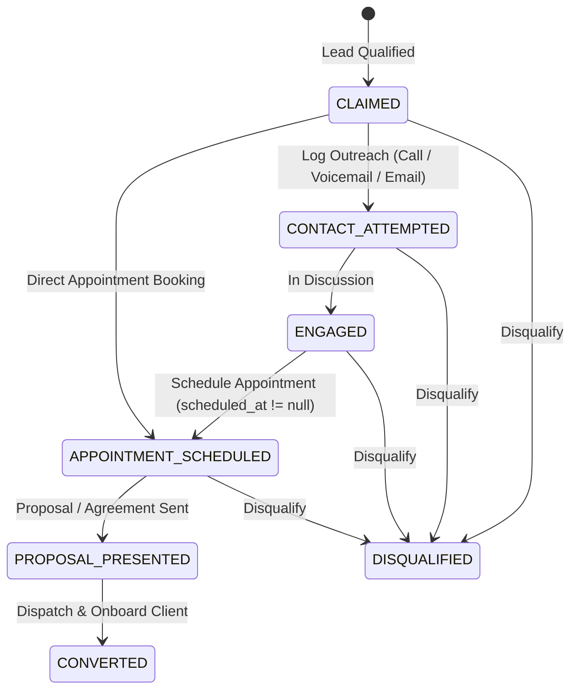

# 0007: Opportunity Engagement Lifecycle States

## 1. Entity Overview

* **Entity Name:** `OpportunityEngagementStage`
* **Owning Slice:** `features/opportunity-dossier`
* **Parent Prospect Entity:** `smb-ops-backend/src/smb_ops_api/core/models/prospect.py`

## 2. State Definitions

* `CLAIMED`: Initial state upon qualification from Discovery Pool.
* `CONTACT_ATTEMPTED`: Operator has initiated contact (e.g. phone call left voicemail, email dispatched).
* `ENGAGED`: Active two-way communication established with owner, general manager, or gatekeeper.
* `APPOINTMENT_SCHEDULED`: A confirmed date/time is booked for a consultation, site review, or pitch.
* `PROPOSAL_PRESENTED`: Service proposal or contract terms submitted for stakeholder review.
* `CONVERTED`: Successfully transitioned to an active Client Account.
* `DISQUALIFIED`: Archival state when the lead refuses service or is suppressed.

## 3. Transition Matrix

| Source State | Trigger Event | Guard / Precondition | Target State | Side Effect / Action |
| :--- | :--- | :--- | :--- | :--- |
| `CLAIMED` | `LOG_ACTIVITY` | channel in (`VOICEMAIL`, `PHONE_CALL`, `EMAIL`) | `CONTACT_ATTEMPTED` | Updates prospect stage |
| `CONTACT_ATTEMPTED`| `LOG_ACTIVITY` | channel in (`PHONE_CALL`, `IN_PERSON_VISIT`) & notes indicate conversation | `ENGAGED` | Updates prospect stage |
| `CLAIMED` / `ENGAGED`| `LOG_ACTIVITY` | `scheduled_at != null` | `APPOINTMENT_SCHEDULED` | Sets appointment datetime badge; updates stage |
| `APPOINTMENT_SCHEDULED`| `MANUAL_ADVANCE` | Operator confirms proposal dispatched | `PROPOSAL_PRESENTED` | Updates prospect stage |
| Any State | `CONVERT_CLIENT` | Agreement reached | `CONVERTED` | Dispatches to Client Onboarding Pipeline |
| Any State | `DISQUALIFY` | Operator terminates pursuit | `DISQUALIFIED` | Archives lead |

## 4. State Diagram

