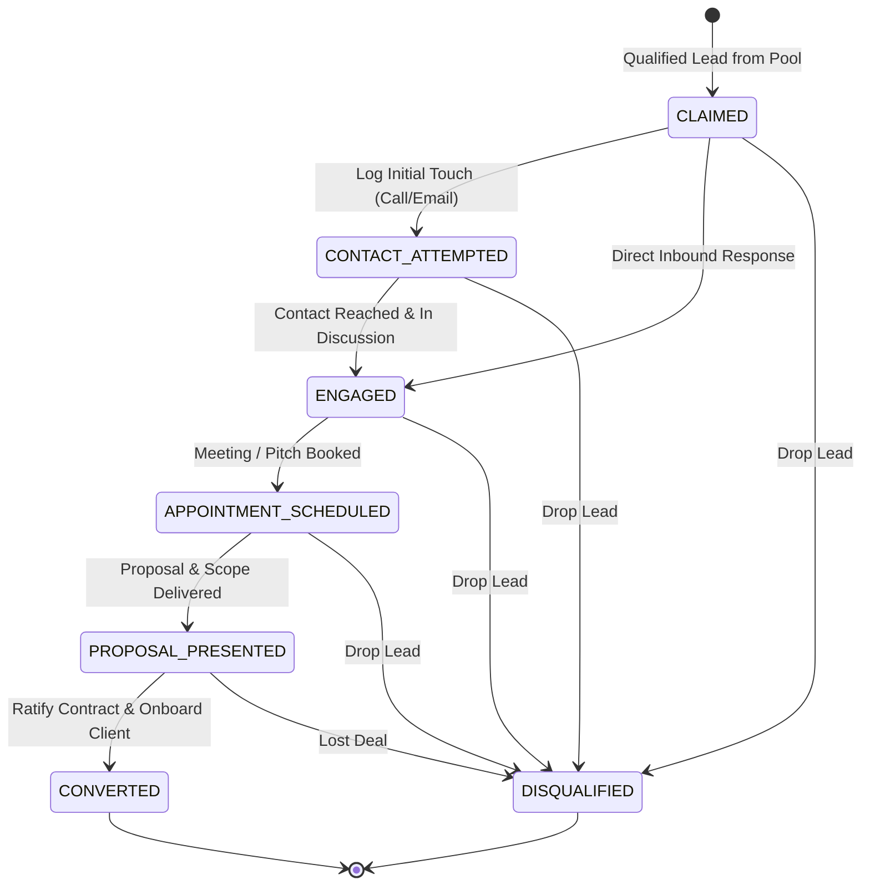

# 0012: Pursued Opportunity Pipeline Lifecycle States

## 1. Overview & Architectural Invariants

The Pursued Opportunity Pipeline workspace (`PursuedLeadsView.vue`) governs high-touch commercial progression of qualified leads (`status = 'PURSUED' | 'QUALIFIED'`). Its lifecycle tracks deals from intake claims through appointment setting and proposal delivery, culminating in conversion into active client accounts or disqualification/archival.

* **Invariant 12.1 (Stage Exclusivity):** Every opportunity in the pursued pipeline exists in exactly one canonical `OpportunityStage` (`claimed`, `contact_attempted`, `engaged`, `appointment_scheduled`, `proposal_presented`).
* **Invariant 12.2 (Conversion Terminal State):** Advancing an opportunity via `CONVERT_TO_CLIENT` transitions the lead out of the Pursued Pipeline (`status = 'CONVERTED'`) and into the Client Accounts ledger (`/clients`).
* **Invariant 12.3 (Archival Terminal State):** Executing `DISQUALIFY_LEAD` transitions the prospect to `status = 'DISQUALIFIED'`, immediately removing it from the active pursued table.

---

## 2. State Definitions

| State | Scope | Description | Allowed Actions |
| :--- | :--- | :--- | :--- |
| `CLAIMED` | Initial | Qualified from discovery pool; ready for initial contact outreach. | `LOG_ACTIVITY`, `DISCOVER_CONTACTS`, `DISQUALIFY` |
| `CONTACT_ATTEMPTED` | Mid | Initial outreach dispatched (voicemail, email, phone call). | `LOG_ACTIVITY`, `ADVANCE_STAGE`, `DISQUALIFY` |
| `ENGAGED` | Active | Active bidirectional communication with stakeholder established. | `LOG_ACTIVITY`, `SCHEDULE_APPOINTMENT`, `DISQUALIFY` |
| `APPOINTMENT_SCHEDULED` | Active | Confirmed discovery or consultation date/time on schedule. | `LOG_ACTIVITY`, `PRESENT_PROPOSAL`, `DISQUALIFY` |
| `PROPOSAL_PRESENTED` | Late | Commercial proposal and pricing options delivered to client. | `CONVERT_CLIENT`, `LOG_ACTIVITY`, `DISQUALIFY` |
| `CONVERTED` | Terminal | Agreement closed; onboarded into active Client Accounts ledger. | None (Archived from `/pursued`) |
| `DISQUALIFIED` | Terminal | Dropped from pipeline with documented disqualification reason. | None (Archived from `/pursued`) |

---

## 3. Transition Matrix

| Source State | Event Trigger | Guard Condition | Target State | Side Effect / Action |
| :--- | :--- | :--- | :--- | :--- |
| `CLAIMED` | `LOG_OUTREACH` | `channel in ['phone_call', 'email', 'voicemail']` | `CONTACT_ATTEMPTED` | Updates `prospect.opportunity_stage`, adds activity |
| `CLAIMED` / `CONTACT_ATTEMPTED` | `RECORD_ENGAGEMENT` | Operator marks active discussion | `ENGAGED` | Updates `prospect.opportunity_stage` |
| `ENGAGED` / Any Pre-Closing | `BOOK_APPOINTMENT` | `scheduled_at != null` | `APPOINTMENT_SCHEDULED` | Sets appointment timestamp |
| `APPOINTMENT_SCHEDULED` | `DISPATCH_PROPOSAL` | Scope & quote selected | `PROPOSAL_PRESENTED` | Marks proposal submitted |
| `PROPOSAL_PRESENTED` | `CONVERT_TO_CLIENT` | Agreement ratified | `CONVERTED` | Dispatches `onboardClient`, creates account, removes from pursued |
| Any Active State | `DISQUALIFY` | Loss reason provided | `DISQUALIFIED` | Calls `disqualifyLead`, removes from active table |

---

## 4. State Diagram

