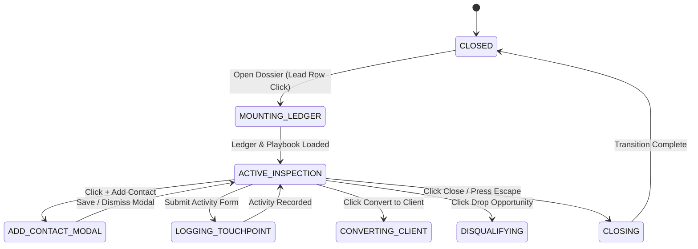

# 0013: Opportunity Dossier Overlay Lifecycle States

## 1. Overview & Architectural Invariants

The Opportunity Dossier Overlay (`OpportunityDossierDrawer.vue`) manages the inspection, stakeholder registry, and commercial activity logging lifecycle for a specific lead or opportunity.

* **Invariant 13.1 (Portal Encapsulation):** The overlay mounts strictly to `#drawer-portal` and may never nest another drawer. Secondary dialogs (e.g., Add Contact, Disqualify) mount to `#modal-portal`.
* **Invariant 13.2 (Idempotent Ledger Loading):** Whenever the drawer transitions from `CLOSED` to `ACTIVE_INSPECTION`, contacts, outreach activities, and the commercial playbook are fetched in parallel for the active `prospect.id`.
* **Invariant 13.3 (Clean Closure):** Closing the drawer resets local contact form state and clears selected targets, returning the viewport to pure route stage interaction.

---

## 2. State Definitions

| State | Scope | Description |
| :--- | :--- | :--- |
| `CLOSED` | Inactive | Overlay is not mounted in DOM (`show === false`); viewport shows underlying stage. |
| `MOUNTING_LEDGER` | Transition | Drawer slides open; parallel fetching of contacts, activities, and playbook underway. |
| `ACTIVE_INSPECTION` | Interactive | Dossier fully rendered; operator reviews vitals, pitch scripts, and engagement hub. |
| `ADD_CONTACT_MODAL` | Sub-dialog | Modal dialog open over drawer for entering new stakeholder name, role, and channels. |
| `LOGGING_TOUCHPOINT` | Asynchronous | Outreach activity submission in flight to backend API. |
| `CONVERTING_CLIENT` | Event Hand-off | Operator clicked "Convert to Client"; emits `convert` and delegates to onboarding modal. |
| `DISQUALIFYING` | Event Hand-off | Operator clicked "Drop Opportunity"; emits `disqualify` and delegates to disqualification modal. |
| `CLOSING` | Transition | Operator pressed `Escape`, clicked close button, or backdrop; drawer slides closed. |

---

## 3. Transition Matrix

| Source State | Trigger Event | Guard / Precondition | Target State | Side Effect / Action |
| :--- | :--- | :--- | :--- | :--- |
| `CLOSED` | `OPEN_DRAWER` | `lead != null` | `MOUNTING_LEDGER` | Slides in drawer, triggers `loadLedgerData` and `loadPlaybookData` |
| `MOUNTING_LEDGER` | `DATA_RESOLVED` | API requests complete | `ACTIVE_INSPECTION` | Renders contacts, scripts, and activity timeline |
| `ACTIVE_INSPECTION` | `CLICK_ADD_CONTACT` | None | `ADD_CONTACT_MODAL` | Opens `BaseModal` with contact form |
| `ADD_CONTACT_MODAL` | `SAVE_CONTACT` | `name && role_title` | `ACTIVE_INSPECTION` | Calls `store.addContact`, appends contact, closes modal |
| `ADD_CONTACT_MODAL` | `CANCEL_CONTACT` | None | `ACTIVE_INSPECTION` | Closes modal without mutation |
| `ACTIVE_INSPECTION` | `SUBMIT_ACTIVITY` | `summary != null` | `LOGGING_TOUCHPOINT` | Calls `store.addActivity`, prepends activity to feed |
| `LOGGING_TOUCHPOINT` | `ACTIVITY_SAVED` | None | `ACTIVE_INSPECTION` | Clears summary input, refreshes ledger |
| `ACTIVE_INSPECTION` | `CLICK_STAGE_STEP` | `targetStage != current` | `ACTIVE_INSPECTION` | Calls `store.setOpportunityStage`, updates stepper badge |
| `ACTIVE_INSPECTION` | `CLICK_CONVERT` | None | `CONVERTING_CLIENT` | Emits `convert(lead)` to parent container |
| `ACTIVE_INSPECTION` | `CLICK_DISQUALIFY` | None | `DISQUALIFYING` | Emits `disqualify(lead)` to parent container |
| Any Active State | `DISMISS` | Click ✕, Backdrop, or `Esc` | `CLOSING` | Slides out drawer; resets selected target |
| `CLOSING` | `TRANSITION_END` | Animation completes | `CLOSED` | Unmounts overlay content |

---

## 4. State Diagram

