# 0014: Client Accounts and Retainers Lifecycle States

## 1. Overview & Architectural Invariants

The Client Accounts & Retainers Workspace (`ClientAccountsView.vue`) governs the lifecycle of operational client accounts (`ClientAccount`), their associated service contracts (`ContractAgreement`), timecards (`Timecard`), continuity health probes (`ContinuityHealth`), and credential vaults.

* **Invariant 14.1 (Account State Exclusivity):** Every client account exists in exactly one canonical `state` (`onboarding`, `active`, `dormant`, `cancelled`).
* **Invariant 14.2 (Retainer Enforcement):** Monthly maintenance logged against a client account tracks towards a defined cap (`monthly_retainer_cap_minutes`). Exceeding this cap activates the `out_of_scope_flag` on the timecard.
* **Invariant 14.3 (Contract Lifecycle Independence):** A client account may hold multiple contracts simultaneously (e.g. Core Service implementation + Recurring Care Plan), each maintaining its own discrete status (`draft`, `active`, `cancelled`, `completed`).

---

## 2. State Definitions

| State | Scope | Description | Allowed Actions |
| :--- | :--- | :--- | :--- |
| `ONBOARDING` | Initial | Newly converted client; onboarding wizard or credential ingestion in progress. | `LOG_WORK`, `ATTACH_CONTRACT`, `ADD_SECRET`, `ACTIVATE_ACCOUNT` |
| `ACTIVE` | Operational | Active monthly retainer or ongoing service engagement. | `LOG_WORK`, `ATTACH_CONTRACT`, `ADD_SECRET`, `RUN_DIAGNOSTICS`, `DEACTIVATE` |
| `DORMANT` | Idle | Retainer paused or inactive; historic logs and credentials retained. | `REACTIVATE`, `ADD_SECRET`, `ATTACH_CONTRACT` |
| `CANCELLED` | Terminal | Agreement terminated; credentials locked or purged. | `VIEW_ARCHIVE` |

---

## 3. Transition Matrix

| Source State | Event Trigger | Guard Condition | Target State | Side Effect / Action |
| :--- | :--- | :--- | :--- | :--- |
| `ONBOARDING` | `COMPLETE_ONBOARDING` | Contract signed & initial secret ingested | `ACTIVE` | Account state set to `active`; notification banner rendered |
| `ACTIVE` | `PAUSE_RETAINER` | Client requests maintenance freeze | `DORMANT` | Maintenance alerts suppressed |
| `DORMANT` | `RESUME_RETAINER` | Client reactivates care plan | `ACTIVE` | Maintenance tracking restored |
| `ACTIVE` / `DORMANT` | `TERMINATE_ACCOUNT` | Operator confirms cancellation | `CANCELLED` | Account marked cancelled; contracts set to `cancelled` |
| Any State | `LOG_WORK` | Minutes > 0 and description provided | (Same) | `store.logWork(clientId, payload)`, updates timecard gauge |
| Any State | `ATTACH_CONTRACT` | Valid service code and rate | (Same) | `store.attachContract(clientId, payload)`, adds contract card |
| Any State | `ADD_SECRET` | Valid credential payload | (Same) | `store.storeSecret(clientId, payload)`, encrypts and stores in vault |

---

## 4. State Diagram

```mermaid
stateDiagram-v2
    [*] --> ONBOARDING: Lead Converted to Client
    ONBOARDING --> ACTIVE: Complete Setup & Sign Contract
    ACTIVE --> DORMANT: Pause Retainer
    DORMANT --> ACTIVE: Reactivate Retainer
    ACTIVE --> CANCELLED: Contract Terminated
    DORMANT --> CANCELLED: Contract Terminated
    CANCELLED --> [*]
```

