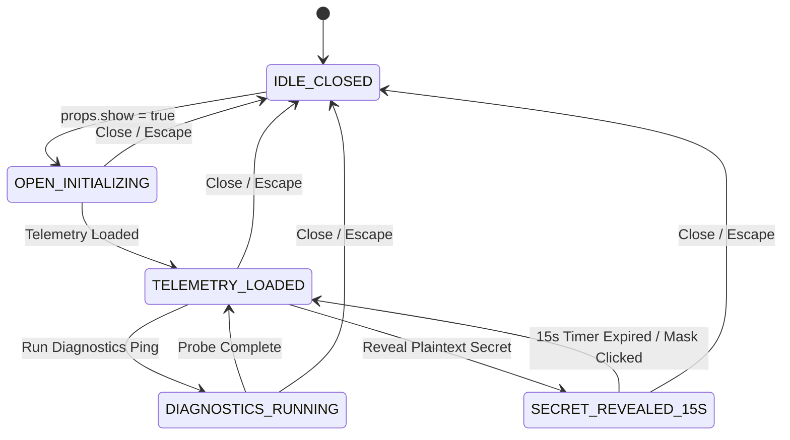

# 0015: Client Dossier Overlay Lifecycle States

## 1. Overview & Architectural Invariants

The Client Dossier Overlay (`ClientDossierDrawer.vue`) governs the deep operational inspection and management lifecycle for a selected client account (`ClientAccount`). It coordinates real-time telemetry loading, asynchronous diagnostics pings, git commit sha attachments, encrypted credential reveals with automated 15-second expiration timers, and modal delegations.

* **Invariant 15.1 (Mounting Exclusivity):** The drawer renders DOM elements if and only if `props.show === true` and `props.client !== null`. When closed (`show === false`), no overlay or canvas markup remains mounted in the DOM.
* **Invariant 15.2 (15-Second Secret Auto-Masking):** Any plaintext secret reveal initiated via `revealSecret` automatically reverts to masked ciphertext exactly 15 seconds after activation, purging plaintext from component memory.
* **Invariant 15.3 (Clean Modal Delegation):** Interactive creation actions (`+ Log Work`, `+ Attach Care Plan`, `+ Add Secret`) emit typed events to the parent workspace without creating nested modal stacking inside the drawer.

---

## 2. State Definitions

| State | Scope | Description | Allowed Actions |
| :--- | :--- | :--- | :--- |
| `IDLE_CLOSED` | Inactive | Overlay unmounted; `props.show = false`. | `MOUNT_DRAWER` |
| `OPEN_INITIALIZING` | Active | Slideout mounted; concurrent fetching of timecard, continuity, and secrets initiated. | `CLOSE_DRAWER` |
| `TELEMETRY_LOADED` | Operational | All account profile, contracts, timecard, and secret cards rendered and interactive. | `RUN_DIAGNOSTICS`, `REVEAL_SECRET`, `TAG_COMMIT`, `DELEGATE_MODAL`, `CLOSE_DRAWER` |
| `DIAGNOSTICS_RUNNING` | Asynchronous | Ping probe in flight (`pingingContinuity = true`); probe button disabled. | `WAIT_RESPONSE`, `CLOSE_DRAWER` |
| `SECRET_REVEALED_15S` | Ephemeral | Plaintext credential visible; active countdown decrementing from 15s to 0s. | `COPY_SECRET`, `MASK_SECRET`, `PURGE_SECRET` |

---

## 3. Transition Matrix

| Source State | Event Trigger | Guard Condition | Target State | Side Effect / Action |
| :--- | :--- | :--- | :--- | :--- |
| `IDLE_CLOSED` | `OPEN_DOSSIER` | `show === true && client != null` | `OPEN_INITIALIZING` | Mounts `.workspace-canvas`, fetches telemetry |
| `OPEN_INITIALIZING` | `TELEMETRY_RESOLVED` | `Promise.allSettled` resolves | `TELEMETRY_LOADED` | Renders `MaintenanceGauge`, contracts, and vault |
| `TELEMETRY_LOADED` | `RUN_DIAGNOSTICS` | `pingingContinuity === false` | `DIAGNOSTICS_RUNNING` | Invokes `store.pingContinuity(client.id)` |
| `DIAGNOSTICS_RUNNING` | `PROBE_RESOLVED` | Ping probe completes | `TELEMETRY_LOADED` | Updates `continuity` reactive ref with probe timestamps |
| `TELEMETRY_LOADED` | `REVEAL_SECRET` | Secret ID not currently revealed | `SECRET_REVEALED_15S` | Fetches plaintext; starts 15s interval timer |
| `SECRET_REVEALED_15S` | `TIMER_EXPIRED` | `remainingSeconds <= 0` | `TELEMETRY_LOADED` | Clears interval timer; reverts secret to masked dots |
| Any State | `TRIGGER_LOG_WORK` | User clicks "+ Log Work" | (Same) | Emits `(e: 'log-work', client, hasActiveCarePlan)` |
| Any State | `TRIGGER_ATTACH_CONTRACT` | User clicks "+ Attach Care Plan" | (Same) | Emits `(e: 'attach-contract', client)` |
| Any State | `TRIGGER_ADD_SECRET` | User clicks "+ Add Secret" | (Same) | Emits `(e: 'add-secret', client)` |
| Any Active State | `CLOSE_EVENT` | Close button / `Escape` key / Overlay click | `IDLE_CLOSED` | Clears active reveals; emits `(e: 'close')` |

---

## 4. State Diagram

