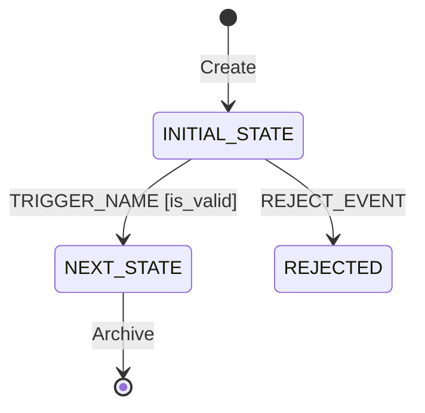

# Entity State Transition Specifications

## Purpose

The **Entity State Transition Specification** defines the authoritative lifecycle of domain entities in the frontend application. It bridges the gap between backend domain invariants and frontend view behavior by formally documenting every valid state, allowable transition, triggering event, and guard condition.

Both human developers and LLM agents reference this document to:
* Ensure UI action buttons are disabled or enabled deterministically based on entity state.
* Prevent illegal state mutations on the client prior to dispatching network requests.
* Model client-side optimistic UI updates and Pinia store mutations accurately.

## File Naming Convention

All specification documents in this directory must follow sequential four-digit numbering:
```text
0001_<entity_name>_state_transitions.md
0002_lead_state_transitions.md
```

## Schema & Core Properties

Every document authored in this directory must define the following properties:

1. **Entity Aggregate:** The domain entity name (e.g., `Lead`, `AuditRecord`).
2. **State Enumeration:** Exhaustive list of discrete states (e.g., `Discovered`, `Audited`, `Ranked`, `Contacted`, `Disqualified`).
3. **State Invariants:** Business rules that must hold true while the entity is in a given state.
4. **Transition Matrix:** Complete mapping of `Current State` + `Event` + `[Guard Condition]` $\rightarrow$ `Next State`.
5. **Visual State Diagram:** Mermaid `stateDiagram-v2` illustrating all legal paths and terminal states.

## Document Template

Use the following template when authoring a new state transition document:

```markdown
---
title: "000X: <Entity Name> State Transitions"
tags: ["architecture", "state-transitions", "<entity-slug>"]
created_at: "YYYY-MM-DD"
last_updated_at: "YYYY-MM-DD"
---

# 000X: <Entity Name> State Transitions

## 1. Entity Overview

* **Entity Name:** `<DomainEntity>`
* **Primary Identifier:** `<id_field>`
* **Owning Domain / Slice:** `entities/<entity-slice>`
* **Backend Source of Truth:** `smb-ops-backend/src/smb_ops_api/core/models/<entity>.py`

## 2. State Definitions

* `INITIAL_STATE`: Description of state and invariants.
* `INTERMEDIATE_STATE`: Description of state and invariants.
* `TERMINAL_STATE`: Final outcome state; transitions halted.

## 3. Transition Matrix

| Source State | Trigger Event | Guard / Precondition | Target State | Side Effect / Action |
| :--- | :--- | :--- | :--- | :--- |
| `INITIAL_STATE` | `TRIGGER_NAME` | `is_valid == true` | `NEXT_STATE` | Dispatches domain command |
| `INITIAL_STATE` | `REJECT_EVENT` | None | `REJECTED` | Logs rejection reason |

## 4. State Diagram



## 5. UI Guard Rules

* When state is `INITIAL_STATE`: `<Action Button>` is active; `<Secondary Action>` is disabled.
* When state is `TERMINAL_STATE`: All editing inputs are rendered read-only.
```
